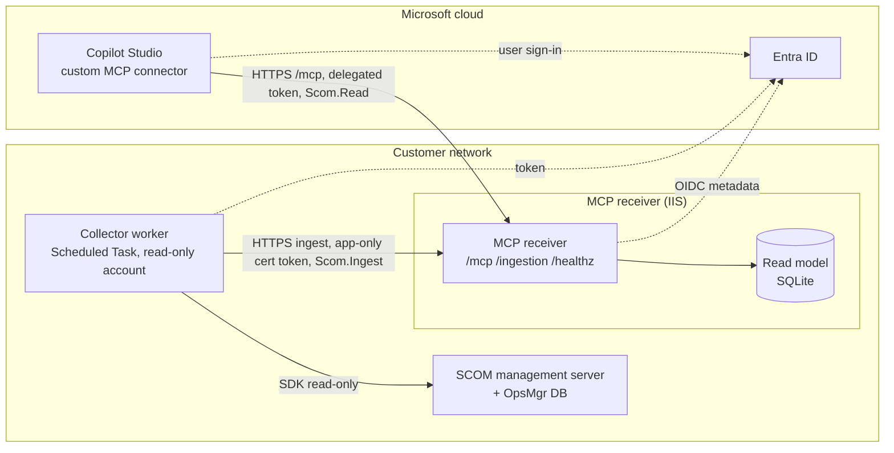

# SCOM MCP for Copilot Studio

Ask Copilot Studio natural-language questions about your System Center Operations Manager
(SCOM) inventory (what computers exist, which OS they run, how much disk they have, which are nearing
end of support) and get answers from a retained snapshot, with **zero query-time load on SCOM**.
A scheduled, read-only collector reads SCOM and publishes to an Entra-protected MCP server
you host; the agent only ever talks to that server.

## 2. Benefits

- **Read-only.** The collector uses a Read-Only Operator account; no tool changes anything.
- **Scheduled collector.** The agent never touches SCOM; question volume does not affect SCOM.
- **Entra-protected.** Delegated, allow-listed reader tokens for questions; app-only, certificate-based publisher identity for ingestion; no secrets in server or worker configuration.
- **Truthful disclosure.** Every answer carries `collected_at`, coverage and freshness, and reports stale or partial data instead of hiding it.
- **On-prem data stays on-prem.** The inventory lives in a read model on your server; only query results flow to Copilot Studio.

## 3. Architecture

Details: [docs/architecture.md](docs/architecture.md).

## 4. What it answers

**Today:** inventory by OS and counts, disks per server, OS lifecycle / end-of-support
(`list_os_support_assessments`), and health **as of the last collection**.
Tools: `get_source_status`, `list_devices`, `get_device_details`, `get_inventory_summary`,
`get_capacity_summary`, `list_os_support_assessments` ([spec](docs/mcp-server-spec.md)).

**Not:** live health, metrics or performance, network devices, licensing or entitlement.
See [docs/limitations.md](docs/limitations.md).

## 5. Quick start

Prerequisites box:

> Windows Server with IIS and the .NET 8 Hosting Bundle · a TLS certificate for `<FQDN>`
> trusted by the server and by Copilot Studio (public or enterprise CA) · the server must
> resolve its own `<FQDN>` · an Entra tenant where you can register apps and consent · a SCOM
> management group and a dedicated read-only domain account (with Allow log on locally) ·
> Operations Manager console or PowerShell module on the collector host · Copilot Studio
> access in the same tenant.

**Supported SCOM versions.** Validated: SCOM 2025 (lab SDK assemblies `7.0.5000.0`, file
version `10.25.x`). Expected: SCOM 2019/2022/2025 (same SDK and Windows Library MP; verify with
`New-ScomMappingProfile`). Not supported: SCOM 2016 and earlier (out of Microsoft support);
SCOM Managed Instance untested.

**Follow the [deployment guide](docs/deployment-guide.md)** for one numbered walkthrough that
tracks every value (app IDs, thumbprints, URLs) from the step that creates it to each step that
uses it. The eight steps below are the short version.

1. Understand the design: [architecture](docs/architecture.md), [security](docs/security.md), [sizing and scope](docs/sizing-and-scope.md).
2. Open the network path: [network and ports](docs/network-and-ports.md).
3. Create Entra registrations: [entra-setup](docs/entra-setup.md).
4. Create the accounts and permissions: [service-accounts](docs/service-accounts.md).
5. Prepare config from the examples: [`receiver.example.json`](examples/receiver.example.json), [`worker.example.json`](examples/worker.example.json), [`identity.example.json`](examples/identity.example.json).
6. Install (elevated Windows PowerShell 5.1): [CLI runbook](docs/install-cli.md) (validated) or the [wizard](docs/install-wizard.md) (evaluation).
7. Connect Copilot Studio: [copilot-studio-integration](docs/copilot-studio-integration.md) and [agent instructions](examples/agent-instructions.md).
8. Register recurrence and operate: [operations](docs/operations.md); problems: [troubleshooting](docs/troubleshooting.md).

## 6. Status

Lab-validated on a 3-server Windows Server 2022/2025 lab, 18–19 Nov 2026. Unsigned community
release, not production-certified. Current release:
[v0.1.0-lab](https://github.com/AhmedElshawa/scom-mcp-server/releases/tag/v0.1.0-lab).
Whole-management-group scope is validated on 3 servers only; start with group scope — see
[sizing-and-scope](docs/sizing-and-scope.md). See [limitations](docs/limitations.md).

## 7. Screenshots

Redacted screenshots of the agent answering and the setup wizard are pending; the capture
list and naming are in [docs/screenshots/README.md](docs/screenshots/README.md).

## Documentation

### Start here

| Document | Purpose |
|---|---|
| [deployment-guide](docs/deployment-guide.md) | End-to-end numbered walkthrough with a values register linking each value to the steps that use it |
| [architecture](docs/architecture.md) | Components, data flow and identities |
| [install-cli](docs/install-cli.md) | Validated step-by-step install runbook |
| [install-wizard](docs/install-wizard.md) | Evaluation GUI walkthrough |
| [entra-setup](docs/entra-setup.md) | The three Entra app registrations |
| [network-and-ports](docs/network-and-ports.md) | Ports, firewall/NSG rules, TLS and IIS binding |
| [service-accounts](docs/service-accounts.md) | Worker and IIS identities and the rights they need |
| [copilot-studio-integration](docs/copilot-studio-integration.md) | Connector, connection, agent instructions, acceptance test |
| [mcp-server-spec](docs/mcp-server-spec.md) | Endpoints, tools, schemas, auth, limits, error codes |
| [configuration-reference](docs/configuration-reference.md) | Every receiver and worker setting |
| [operations](docs/operations.md) | Recurrence, logs, policy changes, lifecycle catalog, recovery |
| [sizing-and-scope](docs/sizing-and-scope.md) | Group vs whole-management-group scope and call model |
| [troubleshooting](docs/troubleshooting.md) | Error codes, causes and fixes |
| [security](docs/security.md) | Threat model and what is and is not collected |
| [limitations](docs/limitations.md) | SDK contract limits and stale/partial semantics |

### Reference and history

| Document | Purpose |
|---|---|
| [os-lifecycle-assessment](docs/os-lifecycle-assessment.md) | How OS support-lifecycle assessment works |
| [guided-setup](docs/guided-setup.md) | Resumable setup flow behind the wizard |
| [indexed-deployment-runbook](docs/indexed-deployment-runbook.md) | Indexed-collection deployment details |
| [easy-indexed-upgrade](docs/easy-indexed-upgrade.md) | Three-step indexed evaluation deployment |
| [targeted-live-verification](docs/targeted-live-verification.md) | Optional targeted current-state verification |
| [local-evaluation-signing](docs/local-evaluation-signing.md) | Local signed evaluation derivative |
| [customer-evaluation](docs/customer-evaluation.md) | Release preparation and acceptance checklist |
| [enterprise-readiness-roadmap](docs/enterprise-readiness-roadmap.md) | Gaps and plans toward enterprise use |
| [deployment-issue-log](docs/deployment-issue-log.md) | Deployment issues and fixes found in the lab |
| [technical-reference](docs/technical-reference.md) | Superseded design notes |

**Support and limitations:** read [limitations](docs/limitations.md) and [security](docs/security.md)
before deploying; report problems through [GitHub issues](https://github.com/AhmedElshawa/scom-mcp-server/issues).

## Releases

Tagged releases attach a ZIP, a SHA256 file and an SBOM, with build provenance attestation
(see [CHANGELOG](CHANGELOG.md), [SECURITY](SECURITY.md)). Verify with
`gh attestation verify <zip> --repo AhmedElshawa/scom-mcp-server`.

## Contributing and license

[CONTRIBUTING](CONTRIBUTING.md) · [SECURITY](SECURITY.md) · [LICENSE](LICENSE)
