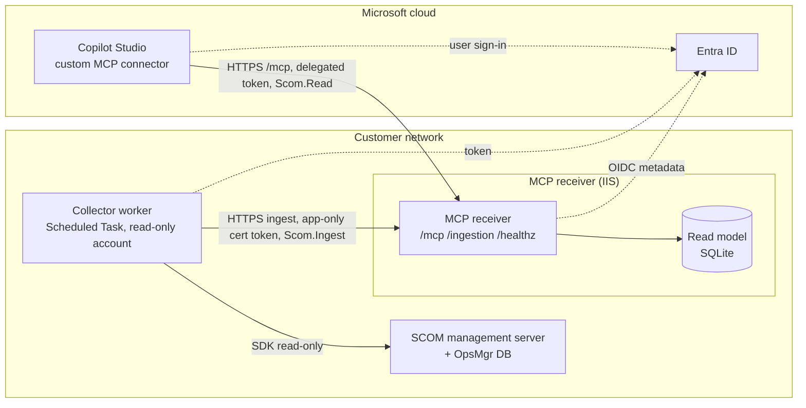

# SCOM MCP for Copilot Studio

Ask Copilot Studio natural-language questions about your System Center Operations Manager
(SCOM) inventory (what computers exist, which OS they run, how much disk they have, which are nearing
end of support) and get answers from a retained snapshot, with **zero query-time load on SCOM**.
A scheduled, read-only collector reads SCOM and publishes to an Entra-protected MCP server
you host; the agent only ever talks to that server.

## 2. Benefits

- **Read-only.** The collector uses a Read-Only Operator account; no tool changes anything.
- **Scheduled collector.** The agent never touches SCOM; question volume does not affect SCOM.
- **Entra-protected.** Delegated, allow-listed reader tokens for questions; app-only, certificate-based publisher identity for ingestion; no secrets in config.
- **Truthful disclosure.** Every answer carries `collected_at`, coverage and freshness, and reports stale or partial data instead of hiding it.
- **On-prem data stays on-prem.** The inventory lives in a read model on your server; only query results flow to Copilot Studio.

## 3. Architecture

Details: [docs/architecture.md](docs/architecture.md).

## 4. What it answers

**Today:** inventory by OS and counts, disks per server, OS lifecycle / end-of-support
(`list_os_support_assessments`), and health **as of the last collection**.

**Not:** live health, metrics or performance, network devices, licensing or entitlement.
See [docs/limitations.md](docs/limitations.md).

## 5. Quick start

Prerequisites box:

> Windows Server with IIS and the .NET 8 Hosting Bundle · a public TLS certificate for your
> `<FQDN>` · an Entra tenant where you can register apps and consent · a SCOM management
> group and a dedicated read-only domain account · Copilot Studio access in the same tenant.

1. Understand the design: [architecture](docs/architecture.md), [security](docs/security.md), [sizing and scope](docs/sizing-and-scope.md).
2. Open the network path: [network and ports](docs/network-and-ports.md).
3. Create Entra registrations: [entra-setup](docs/entra-setup.md).
4. Create the accounts and permissions: [service-accounts](docs/service-accounts.md).
5. Prepare config from the examples: [`receiver.example.json`](examples/receiver.example.json), [`worker.example.json`](examples/worker.example.json), [`identity.example.json`](examples/identity.example.json).
6. Install: [CLI runbook](docs/install-cli.md) (validated) or the [wizard](docs/install-wizard.md) (evaluation).
7. Connect Copilot Studio: [copilot-studio-integration](docs/copilot-studio-integration.md) and [agent instructions](examples/agent-instructions.md).
8. Register recurrence and operate: [operations](docs/operations.md); problems: [troubleshooting](docs/troubleshooting.md).

Reference: [MCP server spec](docs/mcp-server-spec.md) · [configuration reference](docs/configuration-reference.md) · [full legacy technical reference](docs/technical-reference.md).

## 6. Status

Lab-validated on a 3-server Windows Server 2022 lab, 18–19 Nov 2026. Unsigned community
release. See [limitations](docs/limitations.md).

## 7. Screenshots

Redacted screenshots of the agent answering and the setup wizard are pending; the capture
list and naming are in [docs/screenshots/README.md](docs/screenshots/README.md).

## Releases

Tagged releases attach a ZIP, a SHA256 file and an SBOM, with build provenance attestation
(see [CHANGELOG](CHANGELOG.md), [SECURITY](SECURITY.md)). Verify with
`gh attestation verify <zip> --repo <OWNER>/<REPO>`.

## Contributing and license

[CONTRIBUTING](CONTRIBUTING.md) · [SECURITY](SECURITY.md) · [LICENSE](LICENSE)
