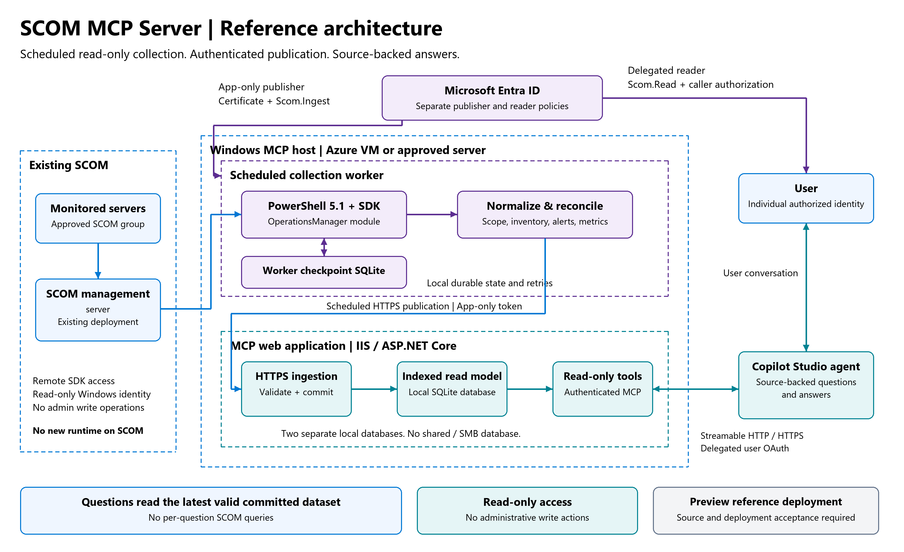

# SCOM MCP Server

[Overview](#solution-overview) | [Key features](#key-features) | [Get started](#get-started) | [Two-server setup](#two-server-deployment-indexed-path) | [IIS and Copilot Studio](#azure-iis-and-copilot-studio-reader-setup) | [Configuration](#indexed-read-model-configuration-opt-in) | [Deployment acceptance](#deployment-acceptance-checklist) | [Security](#security-and-known-limitations)

SCOM MCP Server connects System Center Operations Manager (SCOM) monitoring data
to AI assistants through the Model Context Protocol (MCP). It provides
authenticated, read-only access to inventory, object relationships, alerts, and
selected performance observations, enabling source-backed operational questions
without sending a live SCOM query for every conversation.

Use the solution as a foundation for inventory assistance and monitoring-data
investigation with MCP clients, including Microsoft Copilot Studio. Administrators
control the collection scope, exposed properties, selected metrics, and caller
access. SCOM remains the authoritative source; the server retains a selective,
versioned read model rather than replicating the SCOM databases.

> **Project status: preview.** This project is intended for controlled evaluation
> and customer-specific validation. Production readiness, installed SCOM and
> management-pack compatibility, source collection load, and Copilot Studio
> integration require the [deployment acceptance checklist](#deployment-acceptance-checklist).
> OS support-lifecycle assessment has a bounded, curated Windows Server profile;
> customer acceptance remains required. Administrative write actions are not
> implemented. This is a community project, not a Microsoft-supported product.

## Key features

- **Controlled collection scope:** Collect from an approved SCOM group or an
  explicitly approved whole management group using the opt-in SDK worker.
- **Scheduled updates:** Refresh the read model independently of agent requests,
  with durable checkpoints and retry handling.
- **Read-only operational queries:** Explore objects, relationships, alerts, and
  selected metrics through authenticated MCP tools.
- **Windows inventory and utilization:** Use the six Windows tools with reviewed
  class, property, unit, and hosting mappings. Mixed monitoring roles can be
  represented without labelling management servers as ordinary agents.
- **Explicit data quality:** Preserve freshness, partial coverage, missing values,
  dataset consistency, and pagination boundaries. Missing observations are not
  reported as zero utilization or proof of connectivity.
- **Separated access policies:** Authenticate ingestion publishers separately from
  delegated MCP readers, with configured source and caller authorization.
- **Compatibility path:** Retain the original two-computer snapshot collector and
  its six existing tool contracts, with an additive read-only OS lifecycle tool.

## Solution overview



[Download the architecture picture](docs/images/scom-reference-architecture.png)
or [edit the Excalidraw source](docs/images/scom-reference-architecture.excalidraw).
This reference layout runs the worker and MCP application as separate processes
on the MCP host; it is not evidence of deployment acceptance.

The opt-in indexed configuration separates source collection from conversational
queries:

```text
SCOM -> Scheduled Windows SDK worker -> Authenticated HTTPS ingestion
     -> Server-local SQLite read model -> Authenticated MCP -> AI assistant
```

The worker collects approved data and publishes versioned datasets. The server
validates and activates each dataset before making it available to readers.
Agent questions access the retained dataset, not the SCOM SDK. The worker's
durable checkpoint and the server's query database are separate local stores.

The legacy configuration uses scheduled PowerShell collection and atomic
`snapshot.json` / `collector-status.json` publication instead of HTTPS ingestion.
It remains limited to exactly two configured Windows computers. Do not expand
that collector's scope as a substitute for configuring the indexed path.

## How a Copilot Studio agent can help IT administrators

The MCP supplies **read-only, source-backed evidence for inventory and
troubleshooting**. The agent can explain retained observations and suggest
investigation steps; it cannot guarantee a root cause or perform remediation.
The full configured implementation exposes six existing Windows tools, one
additive OS lifecycle tool, five generic indexed tools and a disabled-by-default
targeted live-verification surface. Availability depends on enabled surfaces, approved scope, exposed
fields, accepted mappings and successfully collected data.

| IT-admin use case / example question | Tool evidence | Important boundary |
|---|---|---|
| "How many approved Windows computers are monitored? Which have this exact OS version?" | `get_inventory_summary`, `list_devices` | Distinct scoped computers, not generic object/volume counts, enterprise totals or proof of current connectivity. OS attributes may be unknown. |
| "Show this computer's OS, memory, processors, volumes and monitoring health." | `get_device_details` | Only observed available attributes. Monitoring health is not a live connectivity test; processor counts do not establish licensing. |
| "What other monitored objects are retained for our approved scope?" | `list_monitored_objects`, `get_monitored_object` | Retained authorized object classes and allowed properties, not server counts or complete SCOM replication. |
| "What retained relationships touch this object?" | `list_object_relationships` | Typed edges with authorized endpoints; coverage does not prove complete topology or causal dependency. |
| "What alerts were observed for this object, and what resolution states are retained?" | `list_monitored_alerts` | History starts at the declared retention boundary; gaps and partial absence do not prove resolution. No alert changes. |
| "Which computers have the highest observed CPU mean over 24 hours, compared with the previous 24 hours?" | `get_utilization` | Selected CPU/memory/disk metrics only; windows 1h/24h/7d, latest/max/arithmetic mean and top up to 20. Not time-weighted or proof of continuous coverage. |
| "Which volumes have less than 10% free space, and what capacity is known?" | `get_capacity_summary` | Memory/disk values as of the dataset; volumes and machines counted separately. Missing totals/usage remain unknown. |
| "Show the retained samples supporting that conclusion." | `list_metric_observations` | Selected raw samples with units, rule, time and optimization flag, not every counter or unlimited history. |
| "When was this data collected, and is the answer incomplete or stale?" | `get_source_status`, coverage/provenance on tool results | Freshness is independent of HTTP health. Failed/unavailable data must not be presented as current complete evidence. |
| "Which approved computers approach the end of extended OS support within a year?" | `list_os_support_assessments` | Exact curated Windows Server product/edition captions only; separate mainstream/extended dates, Microsoft citations, bounded catalog freshness and explicit unknown counts. ESU entitlement is never assumed. |
| "After inspecting this retained critical application alert, its relationships and metrics, can you verify this object's current state?" | `verify_object_current_state` | Opt-in one-object monitoring health/alerts only, via outbound source worker. Transport is implemented/tested with fake sources; a production bounded fresh-scope provider is **not certified or shipped**, so keep disabled. No reachability/RCA or live graph/metrics/remediation. |

**Implementation is not deployment acceptance.** Inventory recovery was reported
in the lab. Metric capabilities require separately verified source rules, units,
timestamps, history/load budgets and collected observations; inventory-only setup
keeps metrics disabled. Customer acceptance must confirm the actual configured
tools, expected scope, allowed/denied users and refresh behavior. Review the
[evaluation gates](docs/customer-evaluation.md) before making customer claims.

**Not provided:** guaranteed root-cause diagnosis, per-question real-time SDK
queries, every SCOM counter, administrative/alert writes, license compliance or
certification of untested platforms. OS assessment uses the
[declared Windows Server coverage profile](docs/os-lifecycle-assessment.md),
not universal OS/build inference or automatic vendor-feed updates.
Generic class support alone does not certify every management pack
or provide Linux/network inventory through the Windows tool contract.

The optional [targeted current-state verification](docs/targeted-live-verification.md)
is an explicit exception to retained-only answering, not a general live proxy.
Its disabled/unavailable states never return retained data labeled as live.

## Get started

**Customer evaluation:** see [release preparation and acceptance gates](docs/customer-evaluation.md).
The indexed path is not a production-certified, turnkey installer.
The [enterprise-readiness roadmap](docs/enterprise-readiness-roadmap.md) records
the audit backlog, staged engineering plan and human-readable operator journey.

1. Review the [configuration model](#indexed-read-model-configuration-opt-in),
   [security limitations](#security-and-known-limitations), and
   [deployment acceptance checklist](#deployment-acceptance-checklist).
2. Download or clone the intended branch or commit. An evaluation branch may
   contain changes that are not yet available on the default branch.
3. Use the [build and validation instructions](#build-and-validate) to run the
   synthetic checks and prepare a package.
4. Follow the [ordered deployment runbook](docs/indexed-deployment-runbook.md) to configure
   the receiving MCP server and source worker. Complete an authorized lab
   publication and reader check before connecting production data or publishing
   an agent.

The repository includes source code, synthetic regression fixtures, configuration
examples, and packaging scripts. Customer configuration, credentials, collected
data, and environment-specific deployment artifacts are not included.

```powershell
pwsh -NoProfile -File .\validate.ps1
pwsh -NoProfile -File .\package.ps1
```

`package.ps1` creates `artifacts\package` and refuses to overwrite an existing
output directory. These commands do not deploy to SCOM or provision permissions.
For live inventory testing, review the indexed read-model/worker configuration
and deployment acceptance checklist below. Example verification flags remain
false, metric mappings empty, and Windows projection disabled. Do not flip
unverified flags merely to make collection run. Inventory acceptance does not
certify metric timestamps, full-history source load, lifecycle answers or
Copilot Studio authentication.

## Two-server deployment (indexed path)

For one ordered procedure from host selection through activation, first commit
and recurring execution, use the
**[step-by-step indexed deployment runbook](docs/indexed-deployment-runbook.md)**.
It includes host responsibilities, paired configuration checks, least-privilege
permissions, explicit completion gates and error-specific recovery guidance.
Confirmed deployment problems, corrections and outstanding verification are
tracked in the [deployment issue and fix log](docs/deployment-issue-log.md).

**Connecting an agent to MCP does not start collection or populate inventory.**
The worker must publish a valid dataset before MCP can answer inventory questions.
Choose the collector location before installing prerequisites. To avoid adding
.NET 8 to an existing SCOM management server, use the following two-server layout:

| Host | Responsibilities | Requirements |
|---|---|---|
| Existing SCOM server | Provide the existing SCOM SDK service for remote read-only access | Existing approved SCOM deployment; no collector runtime installation required |
| MCP server / collector host | Run the worker separately from the MCP application, read SCOM remotely, publish datasets, and serve retained data | .NET 8 and ASP.NET Core 8 runtimes, Windows PowerShell 5.1, compatible OperationsManager module/SDK, read-only SCOM identity, protected local storage, HTTPS and Entra authentication |

A third machine is not required. Install **Operations console only** on the MCP
server from approved, compatible SCOM media; this provides the PowerShell/SDK
components without installing a management server, database, reporting server or
web console. Review supported operating systems, installer prerequisites and
applicable console updates with the SCOM administrator. Follow
[Microsoft's console installation guide](https://learn.microsoft.com/en-us/system-center/scom/deploy-install-ops-console?view=sc-om-2025);
do not copy SDK DLLs manually. If media is unavailable, obtain it through the
organization's approved Microsoft licensing/download channel.

Alternatively, an approved SCOM server or separate Windows SDK host can run the
worker with the required runtimes. In that arrangement the MCP query host does
not need the SDK. Validate source load and local resource impact for either layout.

On the chosen collector host, verify the module in Windows PowerShell 5.1:

```powershell
Get-Module -ListAvailable -Name OperationsManager |
    Select-Object Name, Version, Path
```

In a separate shell running as the approved read-only account, import the module
and test the connection, replacing the example FQDN:

```powershell
Import-Module OperationsManager -ErrorAction Stop
New-SCOMManagementGroupConnection -ComputerName 'scom01.example.com' -ErrorAction Stop
```

The connection uses that shell's Windows identity. Do not send passwords in
commands or grant administrator/logon permissions merely to bypass an error.
A successful connection does not establish complete scope visibility.

### 1. Configure the receiving MCP server

Use `ScomMcp\appsettings.ReadModel.example.json` as the structure for protected
server configuration. Do not copy its synthetic identifiers as deployment values.
Configure HTTPS hosting, delegated reader authorization, the separate ingestion
publisher policy, approved source identity, exposure mappings and local storage
as described in [indexed configuration](#indexed-read-model-configuration-opt-in).
For this path, use `Source:SnapshotEnabled=false` and `ReadModel:Enabled=true`.

The six Windows tools, including `list_devices`, additionally require
`ReadModel:WindowsToolsEnabled=true` and the reviewed Windows projection/hosting
configuration described below. The example deliberately leaves these disabled.
Do not enable them without matching collector and reader mappings.

### 2. Configure the worker on the chosen collector host

Copy the packaged worker executable, collector profile and dependent modules to
approved, protected local paths on the collector host. Use
`ScomMcp\appsettings.Worker.example.json` as the structure for a separate, private
worker JSON file outside the repository. Configure:

- `profile.configuration.managementServer`: the SCOM management-server hostname
  or FQDN, not a URL, shared-folder path or MCP address.
- `profile.configuration.operationsManagerModule`: the installed local
  `OperationsManager.psd1` path.
- The approved management-group/group identity, independently reviewed scope
  gates, Windows mappings, script path/hash, budgets and local checkpoint path.
- `publisher.endpoint`: the receiving MCP application's HTTPS base URL, plus the
  separately provisioned certificate-based publisher identity in `identity`.

Run the worker under the approved Windows account with the read-only SCOM role.
Its PowerShell child inherits that identity and connects to the configured SCOM
server. Configure the execution account through the organization's approved
Windows service/task mechanism; the opt-in [durable Task Scheduler host](Operations/DurableIndexedRefresh/README.md)
provides an explicitly identified worker task, startup recovery, bounded
deferrals and protected logs. Do not put its password in JSON, command-line
arguments, Copilot Studio or this repository. Grant only the required local
file, checkpoint and publisher-certificate access. The SCOM Windows identity
and Entra ingestion publisher identity serve different purposes.
Complete the [publisher identity setup](#publisher-identity-setup-entra-and-windows)
before attempting publication.

The application does not install a service/task, provision identities, sign
scripts or configure HTTPS. Follow approved execution/signing policy; do not
bypass it. Example verification flags are intentionally false and require
actual evidence, not blanket enabling.

### 3. Validate prerequisites, then publish once

Run `collector\Test-SCOMPreflight.ps1` in an approved Operations Manager Shell
on the collector host. It checks metadata only. The optional
`Get-SCOMCompatibilityReport.ps1` is a support diagnostic;
`Get-SCOMMetricCompatibilityReport.ps1` is a separate lab metric diagnostic.
**None of these scripts collects and publishes an inventory dataset.**

After configuration and the applicable
[acceptance checks](#deployment-acceptance-checklist), run the actual packaged
worker once under the intended Windows identity:

```powershell
dotnet 'C:\YourApprovedPackage\ScomMcp.dll' --worker-once 'C:\ProtectedWorker\worker.json'
```

These are placeholder paths. Successful publication requires both server and
worker configuration; this command is not a substitute for that setup. Do not
run the legacy `Collect-SCOMSnapshot.ps1` to populate the indexed database.
Inventory testing does not require performance counters; leave metric mappings
empty until their independent acceptance is complete.

### 4. Confirm data before testing the agent

Confirm that the one-shot worker completed successfully and that authorized MCP
`get_source_status` and inventory calls return the intended dataset and coverage.
`/healthz` alone proves neither collection nor publication. Then configure
supervised recurring execution using the worker's `--worker` mode and reviewed
schedule, and test the same tools through Copilot Studio.

If `list_devices` returns `SOURCE_UNAVAILABLE`, inspect the actual tool error
reason and the effective server data-source configuration first. A
snapshot/status read error indicates the legacy file reader and can mean missing
or unreadable files or invalid JSON; do not install the SDK on the MCP server to
resolve it. In indexed mode, missing, failed, uncommitted or expired source data
also remains unavailable. Do not fabricate fixtures or disable validation to
make the agent return inventory.

## Guided installation

For the double-click experience, extract the complete reviewed evaluation ZIP and
open **`ci-evaluation\ScomSetup.exe`**. The native Windows Forms wizard bundles its
own x64 runtime, so it opens before the app's .NET Hosting Bundle is present.
It starts with automatic read-only prerequisite checks (green PASS / red BLOCKED),
then uses sequential Back/Next screens for log folder, discovered IIS placement,
execution account and source/scope selection. Detailed overrides and real
external evidence gates are kept in Advanced. Separately confirmed installation
stages do not start collection or recurrence merely
by opening. Keep all extracted files together. See the
[double-click quickstart and signing limitations](docs/guided-setup.md#double-click-quickstart).
The evaluation executable is unsigned, not automatically customer-trusted;
normal Windows/UAC and PowerShell signing policies still apply.

For a new opt-in indexed installation, use the
[resumable console setup](docs/guided-setup.md). It separates host prerequisites,
bounded existing-group discovery/selection and staging, authorized customer Entra provisioning,
configuration/IIS activation, explicit one-shot publication and intended-user
acceptance. No Azure infrastructure is created when an existing host suffices.
The evaluation wizard offers separately approved explicit IIS feature and official
signed local .NET 8 Hosting Bundle installation (no installer downloads). It does not infer source verification,
overwrite existing applications or enable recurrence/metrics/live checks.
`Preflight` is the read-only default and blockers stop before deployment journal
or installation writes. The customer chooses a new dedicated IIS pool and
site/application placement, separate local NTFS MCP/collector log destinations,
and either an existing group or separately confirmed whole-management-group
**supported Windows inventory** (never every SCOM class). Structured operational
logs have restrictive identity-specific ACLs and bounded rotation. The complete
package also includes the separately opt-in durable-refresh operations.

## Azure IIS and Copilot Studio reader setup

This procedure configures HTTPS hosting and delegated MCP access. It does **not**
configure the worker publisher or populate inventory. Complete the
[publisher identity setup](#publisher-identity-setup-entra-and-windows) and source
acceptance separately. All hostnames and paths below are generic examples;
replace them in private deployment configuration only.

### 1. Prepare an approved IIS host

Have the platform administrator provision a supported Windows Server host with
IIS and the current approved .NET 8 **Hosting Bundle** (including the ASP.NET Core
Module for IIS). A standalone runtime alone does not provide IIS integration.
Follow [Microsoft's IIS hosting instructions](https://learn.microsoft.com/en-us/aspnet/core/host-and-deploy/iis/?view=aspnetcore-8.0)
for prerequisites, installation order and any required service restart.

Configure a valid TLS certificate, DNS and HTTPS binding. Review Azure NSG,
Windows firewall and proxy rules so the intended Copilot Studio service can reach
the HTTPS endpoint; do not expose management ports or SCOM SDK services publicly.
Use approved network restrictions rather than broadly opening inbound traffic.
Require certificate validation; do not accept unsafe-site warnings as a fix.

### 2. Stage and configure the application

Build and validate in a separate directory using
[build and packaging instructions](#build-and-validate). Copy the complete
`artifacts\package\server` output into a new approved application folder, for
example `C:\ApprovedApps\ScomMcp`. Do not publish directly over a running IIS
deployment or copy only the main DLL. Use a reviewed maintenance/rollback plan
for upgrades.

In IIS Manager, create a dedicated application pool with **.NET CLR version:
No Managed Code** and **Managed pipeline mode: Integrated**. Assign an approved
site/application to that pool and its staged folder. Prefer an application-root
HTTPS binding or an IIS subapplication with a path prefix. Configure the worker's
application base URL to match that routing; it must not include the `/mcp` route.

Retain the package's ASP.NET Core `web.config`. Grant the application-pool
identity read/execute access to application files and the required write access
only to its protected database/log locations. Keep worker checkpoint storage
separate. Do not run the IIS pool under the SCOM account or grant broad write
access to the application directory.

Create protected server settings from the appropriate example and merge any
existing approved authentication configuration. This illustrative `Auth` fragment
is **not** a complete runnable configuration:

```json
{
  "Auth": {
    "TenantId": "<tenant-guid>",
    "Audiences": ["<approved-api-access-token-audience>"],
    "RequiredScope": "Scom.Read",
    "Callers": [
      {
        "ObjectId": "<authorized-user-object-id>",
        "Scopes": ["scom-lab"]
      }
    ]
  }
}
```

`Audiences` must match the API access token's actual `aud`, not the OAuth client's
ID. It is commonly the API client-ID GUID for v2 access tokens; other API token
versions can use a different resource identifier. Verify the API configuration
instead of assuming one format. `RequiredScope` is the delegated `scp` value.
`Callers[].ObjectId` is the authorized user's immutable object ID, not the
connector application's ID. `scom-lab` is the current logical tool scope identifier,
not a customer hostname or SCOM group name.

Configure the actual data source too: either the original two-computer snapshot
path or the opt-in indexed configuration. These paths are not interchangeable.
Inspect IIS/environment overrides as part of configuration review. Do not put
OAuth client secrets in `appsettings.json`. Apply approved changes and restart
only the intended application/pool during its maintenance window, not all IIS sites.

### 3. Register the reader API and OAuth client

If registrations already exist, review/reuse them; do not create duplicates or
overwrite a working connection without a reason.

1. In Entra **App registrations**, create or identify the single-tenant **API
   resource** registration. Under **Expose an API**, configure its approved
   Application ID URI (for example `api://<api-client-id>`) and delegated scope
   `Scom.Read`, with the consent policy approved by the identity administrator.
2. Create or identify a separate single-tenant **Copilot Studio OAuth client**
   registration. Add the API's **delegated** `Scom.Read` permission under
   **API permissions** and obtain consent as required by tenant policy.
3. If using the manual OAuth wizard below, provision a client secret through the
   approved credential process. Enter its value only into the protected connector
   authentication field. Keep it out of source, screenshots, logs and chat, and
   plan expiration/rotation. This is not the worker's certificate credential.
4. Add the wizard-generated callback URI as a **Web** redirect URI on the OAuth
   client registration, exactly as displayed. Do not invent or reuse a callback
   URI from a different environment/connector.

### 4. Connect the agent using manual OAuth

For agents using the supported Copilot Studio MCP onboarding wizard, enable
generative orchestration and open **Tools > Add a tool > New tool > Model Context
Protocol**. UI labels can vary by release. Configure a clear name/description,
the deployment's HTTPS MCP URL (for example `https://mcp.example.com/mcp`), and
**OAuth 2.0 > Manual**. This server does not implement dynamic client registration.
Use Streamable HTTP, not the deprecated SSE transport.

| Wizard field | Value |
|---|---|
| Client ID | Copilot Studio OAuth client Application (client) ID, not the API or worker ID |
| Client secret | Approved OAuth client secret value, entered only in the connector |
| Authorization URL | `https://login.microsoftonline.com/<tenant-id>/oauth2/v2.0/authorize` |
| Token URL template | `https://login.microsoftonline.com/<tenant-id>/oauth2/v2.0/token` |
| Refresh URL | `https://login.microsoftonline.com/<tenant-id>/oauth2/v2.0/token` |
| Scopes | `<api-application-id-uri>/Scom.Read offline_access` |

Select **Create**, record the generated callback URI and have it registered on
the OAuth client as described above. Continue with **Next**, **Create a new
connection**, sign in as the intended authorized user, and **Add to agent**.
Preserve individual-user authentication; do not substitute a shared administrator
connection for caller acceptance.

### 5. Verify the reader and data separately

An HTTPS `GET /healthz` returning 200 proves process reachability only.
Unauthenticated `/mcp` requests must not expose tools. A browser GET, including
a possible 405 response for an unsupported method, is not a successful MCP test:
use the authenticated Streamable HTTP initialization and tool discovery.

Confirm tool discovery, then run `get_source_status`, `list_devices` and
`get_inventory_summary` with an authorized caller after successful collection.
Also test an unauthorized caller, pagination, stale/partial data and intended
source coverage before publishing the agent. Tools loading does not mean data
is available; an MCP tool error can be returned inside an HTTP-success response.

| Symptom | Check |
|---|---|
| HTTP 401 | Token expiry/signature, intended tenant/issuer and exact API audience |
| HTTP 403 | Delegated scope, configured caller object ID and logical tool scope |
| Sign-in/callback failure | Exact generated Web redirect URI, OAuth client ID, secret expiry and tenant consent |
| Tools fail to load | Correct HTTPS MCP route, network/TLS, OAuth connection and supported transport; do not choose None/API key for this JWT-protected server |
| `SOURCE_UNAVAILABLE` | Actual selected data source, last collection/publication, freshness and file/database access; reconnecting OAuth does not populate inventory |

If a connector is demonstrably stale or misconfigured, review its settings and
create a replacement connection only through the approved process. Do not delete
working connections as a generic troubleshooting step.

Reference: [Microsoft's MCP onboarding wizard and authentication instructions](https://learn.microsoft.com/en-us/microsoft-copilot-studio/mcp-add-existing-server-to-agent).
This runbook is deployment guidance, not a claim that every customer environment
or agent configuration has passed integration acceptance.

## Windows MCP tools

- `get_source_status`: dataset freshness, coverage, and capabilities.
- `get_inventory_summary`, `list_devices`, and `get_device_details`: approved
  Windows computers and their discovered logical volumes. The legacy snapshot
  path supports two computers; the indexed path uses verified expected membership.
- `get_utilization` and `get_capacity_summary`: available CPU, memory, and disk
  observations, with timestamps and missing-data limitations.

Responses describe the retained snapshot, not a live SCOM query. Optimized
observations may not cover an entire time window. A successful `/healthz`
response proves only that the process is running; it does not prove that the
source is available or current.

## Legacy snapshot-path prerequisites

- Windows, a SCOM management group, and the OperationsManager PowerShell
  module on the collector host.
- The .NET 8 runtime and a compatible .NET SDK for building the server.
- A Microsoft Entra tenant, an API registration with a delegated scope, and an
  MCP client able to obtain a bearer token for that API.
- Exactly two approved Windows computer FQDNs and their SCOM computer object
  IDs. The server and collector must use the same hostnames.
- A read-only SCOM role for the collector, scoped so its class queries can see
  only the approved computers and their OS and logical-disk instances. The
  collector refuses out-of-scope instances; it is not designed to enumerate an
  entire management group.

## Build and validate

### Check prerequisites and choose a build host

On each intended execution host, inspect the installed .NET components:

```powershell
dotnet --list-sdks
dotnet --list-runtimes
```

If `dotnet` is not recognized, it is not available in that shell; this does not
by itself prove that no installation exists elsewhere. Have the administrator
verify installation and PATH before proceeding. The framework-dependent package
requires the .NET 8 runtime; the ASP.NET Core application also requires
`Microsoft.AspNetCore.App` 8.x, including when using this application's worker
entry point. Use current supported servicing updates through the organization's
approved installation process.

Building requires a compatible SDK capable of targeting .NET 8. Build on a
development/build machine or an approved separate folder on the MCP server;
do not install development tools on the SCOM server solely to build this project.
Copy the resulting package to the approved execution hosts afterward. A source
ZIP is not a runnable package, and extracting it does not install any runtime.
Never extract or publish over a running deployment.

### Restore, validate and package

PR/push CI uses `Offline Windows validation` (`.github\workflows\offline-validation.yml`)
on `windows-2022`, pins SDK `8.0.427` and action commit hashes, and restores locked
NuGet dependencies. It records the checked-out head SHA, runs the same complete
offline harness, validates a fresh evaluation package and retains a seven-day
commit-named artifact containing `scom-evaluation.zip` and its SHA-256 sidecar.
The ZIP includes a per-file SHA-256 manifest and exact source commit identity.
It is a review/evaluation build, not a production-certified installer.
The `Durable indexed refresh synthetic tests` workflow
additionally runs task-host contracts on Windows PowerShell 5.1 and PowerShell 7
and validates checkpoint restart, serialized cycles, process-child cleanup,
status and bounded logs. Neither workflow registers a task or uses customer
secrets, live SCOM, or a production provider. Inspect the actual run conclusion
and tested SHA, not merely the workflow's presence. Branch protection/required-check
settings are separate administrator policy and are not changed here. Local build
commands below may use another compatible installed SDK; CI pins its own SDK
selection.

From the repository root in PowerShell:

```powershell
dotnet restore .\ScomMcp\ScomMcp.csproj
dotnet build .\ScomMcp\ScomMcp.csproj --configuration Release
pwsh -NoProfile -File .\validate.ps1
```

Run each command only after the previous command succeeds. `pwsh` is PowerShell 7
and is required for the validation commands shown here; it is separate from the
Windows PowerShell 5.1 used by the SCOM SDK profile. Do not install tools on a
production host without approval.

The validation harness uses synthetic fixtures and a loopback HTTP server; it
does not access SCOM, publish snapshots, or deploy IIS. Recovery tests start and
terminate only their own identified validation child processes to exercise a
spilled rollback journal and acknowledged staging. Follow your
organization's PowerShell execution and signing policy.

After a successful restore/build, `pwsh -NoProfile -File .\package.ps1` creates a
framework-dependent package in the new `artifacts\package` directory. Publication
excludes project JSON content; the script copies only synthetic configuration
examples, not `appsettings.json` or local settings. Configure the package before
starting it. Do not reuse an existing output directory or treat this as a
production-certified release: it includes both the legacy collector and the
opt-in SDK worker, whose deployment-specific acceptance remains required.

After successful validation, invoke packaging from the same repository root:

```powershell
.\package.ps1
```

The output contains `artifacts\package\server` (application and example settings)
and `artifacts\package\collector` (profile, modules and diagnostics), plus `docs`
with deployment/evaluation guides and architecture assets. Check the package:

```powershell
pwsh -NoProfile -File .\Validation\Test-Package.ps1 -PackageDirectory .\artifacts\package
```

This is a read-only content check, not a clean-host installation or SCOM
certification. Keep these
as a reviewed package; the worker configuration must point to the installed
profile and its reviewed hash. Copying these folders does not configure or start
collection. Configure both receiving server and worker before a one-shot run.
If packaging fails, do not deploy the incomplete output. The script refuses to
reuse an existing output directory; preserve it for inspection and choose a new,
explicit `-OutputDirectory` for a subsequent attempt rather than mixing builds.

### Downloaded scripts and execution policy

If PowerShell reports that `package.ps1` is not digitally signed, inspect policy:

```powershell
Get-ExecutionPolicy -List
```

Do not change policy or use `-ExecutionPolicy Bypass` to make packaging work.
With `RemoteSigned`, a script extracted from an Internet download may retain a
download-zone marker and therefore require a signature. Inspect this specific
file from the repository root:

```powershell
Get-Item -LiteralPath .\package.ps1 -Stream Zone.Identifier -ErrorAction SilentlyContinue
```

Only after reviewing the script and confirming that organizational policy permits
trusting this download, remove the marker from that one file and retry:

```powershell
Unblock-File -LiteralPath .\package.ps1
.\package.ps1
```

`Unblock-File` removes the file's download marker; it does not sign the code or
change execution policy. Do not recursively unblock the repository/package.
If policy requires signatures, or the organization does not permit unblocking,
obtain approved code signing instead. Validation and collector scripts/modules
may independently require review/signing on their execution hosts; a successful
package build does not sign or approve them. Stop on further policy errors rather
than weakening protections.

## Indexed read-model configuration (opt-in)

Copy `ScomMcp\appsettings.ReadModel.example.json` to your protected local server
configuration and replace the synthetic IDs. Provide an existing, protected
server-local database directory; the server creates its SQLite database there.
UNC paths and mapped network drives are rejected. Run one server process/ingestion
writer per database; multi-node/shared-database deployment is not supported.

Configure `ReadModel:ManagementGroupId` and either `ScopeKind: "group"` with
`GroupId`, or explicitly approved `ScopeKind: "managementGroup"` with `GroupId: null`.
The source worker must independently establish complete expected membership under
its read-only role. A publisher's `membershipVerified` declaration is not proof of
SCOM permissions: this foundation trusts an explicitly authorized publisher and
pins the source identity. It cannot establish installed role completeness itself.

`Auth:Callers` must use immutable object-ID grants in this mode. Ingestion uses
the same pinned tenant/audience JWT verification but a **separate app-only policy**:
one approved publisher `oid`, the exact `Scom.Ingest` role, and no delegated `scp`.
Delegated MCP readers cannot publish, and publishers cannot use the reader policy
without a separately valid delegated grant. Customer identity administrators must
configure the API app role, assignment and worker authentication. This code does
not create credentials or authorize deployment. Require TLS and restricted
network/NTFS access outside the synthetic loopback harness.

`AllowedPropertiesByClass` and `AllowedMetricsByClass` are **empty by default**.
Object identity/class/health still work, but discovered properties and metric
names/units require explicit reviewed class mappings. Example mapping structure:

```json
{
  "AllowedPropertiesByClass": {
    "Synthetic.Computer": ["SyntheticCaption"]
  },
  "AllowedMetricsByClass": {
    "Synthetic.Computer": { "syntheticMetric": "count" }
  }
}
```

These are synthetic examples, not usable SCOM mappings. Percent observations are
bounded to 0..100; other metrics remain raw finite values in their approved units.
Alert descriptions are rejected unless `IncludeAlertDescriptions` is explicitly
enabled after a data review; names are retained. Text remains untrusted source
data, not instructions. There is no automatic secret-redaction guarantee.
Scope/property/metric exposure policy is pinned to the database; changing it
requires a reviewed rebuild/migration, not silently serving old disallowed fields.

### Publisher identity setup (Entra and Windows)

This is an administrator provisioning procedure, not something Copilot Studio
users perform. It creates application access and a persistent credential:
obtain the organization's explicit approvals before changing Entra permissions,
issuing/importing certificates or granting private-key access. The repository
does not perform these actions automatically. Preserve the existing delegated
reader configuration; a working Copilot Studio OAuth connection does not
authorize the worker to publish.

There are three distinct identities:

| Identity | Purpose |
|---|---|
| Read-only Windows execution account | Worker process identity, remote SCOM access, local checkpoint and certificate access |
| Worker Entra application/service principal | App-only authentication for HTTPS ingestion |
| Delegated MCP caller | Authorized tool access from Copilot Studio; not an ingestion publisher |

#### 1. Identify the existing API registration

In the Microsoft Entra admin center, open **App registrations** and locate the
API registration corresponding to the receiving server's configured
`Auth:Audiences`. Do not accidentally select the Copilot Studio OAuth client
registration. Under **Expose an API**, record the existing Application ID URI
for private configuration. Do not change its delegated scopes, redirect URIs or
token version as part of this procedure.

The worker requests `<Application ID URI>/.default`. The issued token's audience
must match a value already approved in the server's `Auth:Audiences`; the exact
claim format depends on the API's access-token version. Review this locally
without copying bearer tokens into chat, logs or online token decoders. Do not
weaken audience validation to make an unexpected token work.

#### 2. Define the ingestion application role on the API

On that **API registration**, select **App roles > Create app role**:

| Field | Value |
|---|---|
| Display name | A descriptive name such as `Publish approved SCOM datasets` |
| Allowed member types | **Applications** |
| Value | `Scom.Ingest` (case-sensitive) |
| Description | Publish approved SCOM collection datasets to this API |
| Enable this app role | Enabled |

Save through the authorized administrator's approved process. This application
role is separate from the existing delegated scope such as `Scom.Read`.

#### 3. Register the worker and assign its permission

1. In **App registrations > New registration**, create a dedicated worker app
   using **Accounts in this organizational directory only**. A client-credentials
   worker does not need a redirect URI.
2. Record its **Directory (tenant) ID** and **Application (client) ID** privately.
3. Open its **API permissions > Add a permission > My APIs**, choose the receiving
   API, then **Application permissions > Scom.Ingest > Add permissions**.
4. Have an authorized administrator review and **Grant admin consent** for the
   tenant. Confirm the application permission is granted; adding it to the list
   without consent is not sufficient.
5. In **Enterprise applications**, locate this worker by its application/client
   ID and record its **Object ID**. This is the service-principal object ID used
   in the app-only token's `oid`, not the app-registration Object ID.

The worker does not require Microsoft Graph permissions for this transport.
Do not grant it delegated reader access or reuse a human identity as publisher.

#### 4. Provision the publisher certificate

Have the certificate/security administrator issue and deploy an approved
certificate for the worker. The implementation requires an RSA private key of at
least 2048 bits and uses PS256 assertions; verify that the chosen provider
supports RSA-PSS signing under the worker's execution account.

On the **worker app registration**, open **Certificates & secrets > Certificates
> Upload certificate** and upload only its public certificate (`.cer`, `.pem` or
`.crt`). Do not upload a PFX or private key to the registration.

On the **collector host** (the MCP server in the co-located layout), use the
approved certificate enrollment/import process to place the matching certificate
and private key in **Certificates (Local Computer) > Personal > Certificates**
(`LocalMachine\My`). The worker does not search Current User stores.
For a software private key managed through the Certificates MMC, an authorized
administrator can use **All Tasks > Manage Private Keys** to grant the worker
execution account only the access needed to read/use that key. For other
providers, use the provider's approved access controls. Do not grant broad groups
access or change the IIS application-pool identity to the SCOM account.

Record the certificate thumbprint locally: the worker setting requires the
40-hex-character certificate thumbprint with no spaces. The certificate must be
currently valid and uniquely present in that store. This lookup thumbprint is
not the SHA256 `x5t#S256` assertion header, which the code computes itself.
Never commit private keys, PFX passwords, tokens or customer configuration.

#### 5. Map the identities into private configuration

| Private setting | Source |
|---|---|
| Worker `identity.tenantId` | Worker directory/tenant ID; must match receiving server `Auth:TenantId` |
| Worker `identity.clientId` | Worker **Application (client) ID** |
| Worker `identity.resource` | Receiving API Application ID URI, without `/.default` or a trailing slash |
| Worker `identity.certificateThumbprint` | Matching certificate in collector host `LocalMachine\My` |
| Server `ReadModel:PublisherObjectIds` | Worker **Enterprise application Object ID**, in canonical hyphenated GUID form |
| Server `ReadModel:IngestionRole` | `Scom.Ingest` |
| Worker `publisher.endpoint` | Receiving application's **HTTPS base URL**, including any IIS application path; not the Entra resource URI or `/mcp` route |

**IIS application paths:** the publisher accepts an origin such as
`https://ingestion.example.com/` or an application base such as
`https://ingestion.example.com/monitoring/`. A missing trailing slash is added
internally: both `/monitoring` and `/monitoring/` publish beneath
`/monitoring/ingestion/sessions/...`. Nested application paths are supported.
Configure the application base, not its `/mcp` or `/ingestion` route. Credentials,
query strings and fragments are rejected; HTTPS and normal TLS validation remain
required, and redirects are not followed. Confirm that the intended IIS
application exposes ingestion with the configured publisher policy; a working
reader connection alone does not establish that.

Keep all actual settings outside source. Do not overwrite the current
`appsettings.json` with an example: merge reviewed settings while preserving
reader authorization. Check environment/IIS overrides before an approved restart.
Complete database, source pins, exposure policy and Windows mappings as well;
publisher identity alone does not make `list_devices` available.

#### 6. Verify before recurring execution

Verify certificate access under the actual worker account, permission consent,
TLS routing and matching configuration before an authorized `--worker-once`
attempt. Token acquisition does not by itself prove ingestion authorization:
the server also requires the exact tenant, approved publisher `oid`, assigned
role and an app-only token without a delegated `scp` claim.

Confirm successful publication and the intended authorized dataset through MCP
before enabling the recurring worker. Never use a fixture, disable validation,
or grant broader permissions as a substitute for diagnosing a failure. Protect
both local databases independently. Plan certificate expiry monitoring and
approved rotation, testing the new credential before retiring the old one.

References:
[App roles and application permission assignment](https://learn.microsoft.com/en-us/entra/identity-platform/howto-add-app-roles-in-apps),
[register an app and service principal](https://learn.microsoft.com/en-us/entra/identity-platform/howto-create-service-principal-portal),
and [certificate credentials](https://learn.microsoft.com/en-us/entra/identity-platform/certificate-credentials).

### Ingestion protocol

All operations require the publisher policy. A session ID is a new canonical,
nonzero GUID; the application-generated dataset identity is that session ID.
Only one ingestion HTTP request is admitted at a time, with no waiting queue;
concurrent requests receive HTTP 429 and must retry with backoff.
Batch/commit uploads have a 30-second body-read deadline by default
(`RequestBodyTimeoutSeconds`, range 1..120). An incomplete upload returns HTTP 408
without accepting a batch or committing a dataset; aborted clients propagate
cancellation. This bounds occupancy of the ingestion slot while reading a body,
not the duration of SQLite validation/commit or upstream SCOM work.

`ScomMcp\IngestionPublisher.cs` provides the source-independent .NET 8 worker
transport. Supply an HTTPS application base URL, an in-memory token-acquisition callback and an
asynchronous stream of typed batches plus the verified manifest. It serializes
one batch at a time with encoded-byte and aggregate-record budgets, starts one
session, sends contiguous sequences, verifies each acknowledgement, then commits.
Default transport disables redirects/cookies and uses normal TLS validation.
It stores no tokens, credentials, configuration or source data on disk.

Transient network failures and HTTP 408/429/502/503/504 retry the identical
session/sequence/body with bounded backoff, fresh token acquisition and request/
publication deadlines. Other status codes, redirects, malformed acknowledgements
and budget violations stop publication. Excessive `Retry-After` defers by failing
explicitly rather than retrying early. Overlapping calls on a publisher instance
are rejected. An interrupted or ambiguous commit never automatically calls `/fail`:
the server might already have activated it. Recovery must retain the original
session/bytes while resolving the outcome; do not restart it with a new ID and
claim a known result. Uncommitted staging remains unavailable and expires.

This transport component does not provision tokens or start collection by itself.
The worker host described below composes it with the PowerShell source bridge,
scheduler and checkpoint handling; deployment-specific source/profile validation
is still required. Offline tests simulate lost responses after real store acknowledgements
to prove retry idempotency, and exercise the publisher through the actual
authenticated loopback ingestion endpoints into the indexed store, without
connecting to customer infrastructure. The loopback transport is test-only;
production publishing still requires HTTPS.

`CollectionScheduler` provides a single-run, fixed-delay worker loop around an
injected adapter attempt. Normal delay begins after publication, so missed
periods do not queue scans. Explicit `Deferred` outcomes back off exponentially
to a configured ceiling; the adapter must first reconcile ambiguous ingestion
identities before returning that outcome. Unexpected errors stop with sanitized
diagnostics rather than automatically starting another dataset. A cooperative
deadline cancels the attempt, but the loop waits for noncooperative source work
to finish before stopping; it never abandons an SDK call and starts overlapping
work. The worker host registers this loop in `--worker` mode, not the MCP query
host. An operator must configure and supervise its execution; starting the MCP
query host does not deploy a collection schedule.

`AlertReconciler` provides an offline-tested reconciliation boundary for a worker
that has independently verified current expected scope. Bootstrap records only
observed alerts; subsequent partial/active-only absence never implies resolution.
Previously unresolved alerts missing from a complete active-only scan remain
retained and mark coverage `PRIOR_ALERTS_NOT_REASSESSED`. Only explicit source
resolution-state observations update state (255 is resolved); older or conflicting
same-time observations reject the run. Verified scope removal stops serving an
alert outside the new scope, without synthesizing a resolution event.

Resolved observations expire under a bounded retention policy, advancing the
reported history-start boundary; unresolved alerts are never age-trimmed as though
resolved. Exceeding the alert budget rejects reconciliation rather than silently
truncating incidents. This helper does not query SCOM, prove scope completeness,
persist worker checkpoints or establish the installed source's alert lifecycle
behavior. Worker orchestration must combine it with explicit discovery coverage
and advance checkpoints only after publication acknowledgement.

`CollectionWorker` connects an `IScomCollectionSource` to the publisher and can
serve as the scheduler's attempt callback. `ReserveSessionAsync` establishes the
stable dataset identity; the worker begins ingestion before source collection.
Once a new ingestion session is accepted, prior availability is invalidated before
source collection, so failed/unverified scope refreshes cannot serve old success.
Replaying a retained committed session for checkpoint recovery does not invalidate
availability or start a fresh source scan.
`PrepareAsync` returns that same stable session,
manifest and batch stream without advancing a source watermark. Only acknowledged
publication invokes `AcknowledgeAsync`. Collection, publication or checkpoint
failure propagates and stops automatic scheduling; a source must preserve the
same prepared identity/data while resolving ambiguous outcomes. Acknowledgement
must itself be idempotent. The repository supplies this coordination contract and
offline ordering and actual worker-to-HTTP failure-invalidation tests. Source
profiles still require deployment-specific validation. Durable recovery is opt-in
through the separate worker checkpoint store described below.

`ReconciledCollectionSource` is the concrete `IScomCollectionSource`.
An `IScomNormalizationProfile` returns a normalized scan with independently
verified expected scope, object/relationship discovery, explicit alert observations
and selected complete/incomplete metric intervals. The source validates scope,
reconciles alert/metric history, excludes orphan rows with explicit partial
coverage and emits stable single-domain batches. Pending preparation is reused
until acknowledged; a failed publication does not recollect or advance history.
Verified membership removal takes effect in the next committed dataset.

Scope identity changes require a fresh source instance and reviewed server
configuration rather than mixing reconciliation histories. This implementation
defaults to in-memory preparation/checkpoints: process restart loses them and
requires a fresh bootstrap with a new explicit history start. For restart recovery,
pass a worker-owned `SourceCheckpointStore` to its constructor. The production
A generic approved-group profile is available below, but deployment-verified metric mappings,
the indexed Windows compatibility projection and production certification remain
incomplete. The opt-in worker host/bridge supplies process isolation, not proof
of source completeness. No customer-specific profile is embedded.

The optional `SourceCheckpointStore` uses a **separate, protected worker-local
SQLite file**, never the MCP database or a shared SMB file. Provision its existing
directory with access restricted to the worker account and authorized operators;
the constructor rejects UNC/mapped-network paths and reparse points. It holds an
exclusive ownership lease until disposed. The caller owns its lifetime and must
keep it open throughout collection/scheduling.

Supply a SHA256 of the reviewed normalization-profile configuration/version as
`profilePolicyHash`. This is a compatibility pin, not proof of SCOM authorization.
The store also pins reconciliation settings, including batch sizing. Changed
profile policy, settings, schema or corrupt state rejects startup without silently
resetting history. Reviewed scope changes require a new checkpoint under operator
control, not simply a new source instance using the old file.

Reservation is persisted before ingestion begins; immutable pending data is
persisted before upload; history advances transactionally only on acknowledgement.
Restart restores the pending session, exact batch data, alert history start and
raw metric history without rerunning the source. Failed durable writes do not
advance in-memory state. The current encoded state budget defaults to 32 MiB
(configurable 1 KiB..64 MiB), with a main-file ceiling of 64 KiB plus four times
that budget, rounded to SQLite pages. Provision rollback-journal and operational
headroom separately. State remains plaintext customer operational data; SHA256
integrity checking is not encryption or protection against a privileged writer.
Do not put this file in public source, copy it while live, or log its contents.
Expired/removed server sessions still require operator reconciliation; durable
state does not make server replay retention unlimited.

### Isolated worker host and identity

The packaged .NET executable has two explicit worker modes; neither starts the
MCP HTTP server or loads its reader configuration:

```powershell
dotnet .\ScomMcp.dll --worker-once C:\ProtectedWorker\worker.json
dotnet .\ScomMcp.dll --worker C:\ProtectedWorker\worker.json
```

`--worker-once` publishes one attempt; `--worker` uses the serialized fixed-delay
scheduler. The scheduler retries only safely deferred attempts, with bounded
exponential backoff and a configurable consecutive-attempt limit (default 5);
unexpected failures and exhausted deferrals stop with a nonzero exit code.
Ctrl+C cancels it. Optional `--runtime-state-dir` enables a protected
single-instance lease, bounded rotating logs and a durable status record for the
Task Scheduler host. Diagnostics never contain source payloads or arbitrary
exception messages. The CLI itself does not install a task or choose operator
cadence, freshness limits, credentials or deployment policy; see the
[durable Task Scheduler host](Operations/DurableIndexedRefresh/README.md).
Use `appsettings.Worker.example.json` as a synthetic, deliberately non-runnable
structure, not deployment settings. Keep all actual configuration outside source.

`PowerShellNormalizationProfile` invokes the installed system **Desktop Windows
PowerShell** with `-NoLogo -NoProfile -NonInteractive -File`. It does not bypass
execution policy. The reviewed `.ps1` path must be local, non-reparse, SHA256-pinned
and protected against modification; its digest is checked before each invocation.
Protect all dependent modules/configuration too: a script hash does not validate
its dependencies or replace signed-code policy. The child runs as the worker's
OS identity, which must have the reviewed read-only SCOM role. No credentials
are passed in arguments.

The bridge sends one UTF-8 JSON request on stdin, then closes stdin:
`{"protocolVersion":1,"configuration":{...},"request":{...}}`.
`request` contains `requestedAtUtc`, `metricHistoryStartUtc` (14 days earlier)
and `priorUnresolvedAlerts` as `{alertId,objectId}` pairs restored from acknowledged
worker history. The profile must establish fresh approved membership first,
then reassess only pairs whose parent remains authorized. These pairs are
reconciliation hints, never authorization or proof that an alert is still active.
An absent alert does not establish resolution. Pending replay does not invoke
the profile or generate a new request. Requests exceeding the input budget fail
before starting a child; never truncate the prior-alert set silently.
The script reads stdin rather
than command-line secrets and must emit exactly one UTF-8 JSON result on stdout:
`{"protocolVersion":1,"scan":{...}}`, where `scan` matches
`NormalizedSourceScan` in `ReconciledCollectionSource.cs`. Set console output to
UTF-8 without a BOM. All collections, required completeness flags, UTC times,
coverage reasons and configured source IDs must be explicit. No banners, progress,
SDK object serialization or additional stdout text are allowed. Any stderr or
nonzero exit rejects the scan; stderr is bounded and never logged. The script
must not spawn detached processes or perform write/admin actions.

Input defaults to 64 KiB and output to 16 MiB; absolute ceilings are 1 MiB and
32 MiB. Stdout and stderr are drained concurrently with byte caps, cancellation
and a process deadline. The bridge terminates its tracked process tree on failure
and waits for process/pipe completion before another attempt. These are local
execution safeguards, not proof of bounded SDK/database work or complete role
visibility. A normalization script cannot self-certify authorization completeness.

Publisher identity uses an **existing RSA private-key certificate in
LocalMachine\\My** matching the configured thumbprint. The worker account needs
private-key access; Entra application credentials and app-role assignment must
already be provisioned by an authorized operator. The provider signs fresh,
short-lived PS256 `client_credentials` assertions with `x5t#S256`, following
[Microsoft's certificate assertion format](https://learn.microsoft.com/en-us/entra/identity-platform/certificate-credentials),
and requests
`<resource>/.default` from the configured tenant's public-cloud Entra v2 token
endpoint. Sovereign-cloud authorities are not implemented. It never saves tokens,
exports keys, follows redirects or changes permissions. Delegated MCP readers
remain separate from the app-only publisher and the server still verifies
tenant/audience, `Scom.Ingest` and the approved publisher object ID.

Checkpoint compatibility also pins profile configuration, ingestion destination,
tenant/client identity and resource. Changing those requires reviewed state
reconciliation, not automatic replay to a new destination. Certificate rotation
for the same application is not a profile-policy change.

`ScomSdkReader.psm1` also provides `Read-SCOMDirectRelationshipRows`. It binds the
installed generic `GetRelationshipObjectsWhereSource<T>(Guid,
ManagementPackRelationship, DerivedClassTraversalDepth, TraversalDepth,
ObjectQueryOptions)` signature and queries one source with one-level traversal,
including derived relationship classes. This installed IList-returning overload
rejects positive `ObjectQueryOptions.MaxResultCount`; its setter also rejects
zero despite the getter defaulting to zero. The adapter leaves this property
untouched and rejects a returned list above its local relationship budget,
duplicate IDs, invalid parents and outside-source rows. That budget is checked
after SDK materialization, not a source-side result cap. It never silently retries
a failed query without limits. Independently assess high-fan-out sources and
backend load before accepting the relationship-query contract.
It does not infer approved membership from returned relationships, classify
nested groups, or certify query completeness/source load. Its returned
`ScopeMembershipVerified` and `SourceWorkBoundVerified` remain false; the production
adapter must independently establish those guarantees.

`ConvertTo-SCOMObservedObject` maps one unambiguous most-derived class, its base
classes, SDK health and explicitly allowlisted discovered scalar properties.
Missing properties remain null, raw zero remains zero and ambiguous/non-scalar
values reject. It never infers hosting relationships from paths or hostnames.
`ConvertTo-SCOMObservedAlert` checks an expected parent, preserves explicit
resolution state (including 255), maps observed severity and omits descriptions
unless enabled. These helpers normalize supplied SDK observations; they do not
perform membership verification, alert queries or certify management-pack units.

`Read-SCOMDirectGroupMembers` connects the source-scoped relationship reader to
the nested resolver's direct-member callback. It requires the exact instance-group
membership relationship/base group class, classifies targets through SDK
`IsInstanceOf`, and deduplicates target identities. Its mandatory
`MembershipQueryContractVerified` is an external deployment acceptance gate:
leave it false until the relationship/overflow behavior has been independently
validated. It does not replace the nested resolver's separate
`ScopeVisibilityVerified` requirement. Neither flag may be inferred from an empty
or successful query, and neither establishes measured source-work bounds.

`Invoke-SCOMGenericGroupProfile.ps1` is the runnable **generic source**
profile, using `ScomNormalization.psm1` and the SDK helpers. It checks the
management-group ID and approved root, resolves nested group membership, reads
only those expected object IDs, emits generic class/property/health inventory and
typed instance-group edges, bootstraps active alerts per discovered object, and
reassesses prior unresolved alert IDs only when their parent remains served.
It uses documented `Get-SCRelationship -Name` metadata lookup—not whole-class
instance enumeration—and reuses the same relationship observations for scope
and edges instead of querying every group twice. Scope is the verified membership
captured during that scan; it is not a transactional SCOM-wide snapshot.

The example keeps both acceptance flags false and must not be enabled merely
because SDK signatures match. Independent role-visibility and query-contract
acceptance are still required. Approved-group mode remains the default; the
separately gated whole-management-group mode is described below. Neither mode
infers hosting/dependency topology.
The indexed six-tool Windows view is optional and requires the verified mapping
described below. Without configured verified mappings, metrics remain explicitly partial
with `VERIFIED_METRIC_PROFILE_NOT_CONFIGURED`; an empty series array is **not**
treated as successful metric assessment. Legacy snapshot collection and its six
tools remain unchanged by default. Source-side work/alert result materialization,
membership stability and certification still require measured acceptance.

`Get-SCOMGenericScan` also supports explicitly approved `managementGroup` scope.
`Get-SCOMGenericGroupScan` remains a compatibility alias; its default is still
group scope. The historical entrypoint filename is retained for installed profile
compatibility. For management-group mode, set `scopeKind` to `managementGroup`,
`groupId` to null and independently establish `wholeManagementGroupApproved`,
`scopeVisibilityVerified` and `enumerationQueryContractVerified` before setting
them true. Configure the ingestion server to the same exact management-group
identity and scope kind. Changing a worker or read-model scope requires reviewed
state reconciliation; it never automatically falls back from group to whole-MG.
The checked-in worker example leaves all approval/verification flags false.

`Read-SCOMManagementGroupScope` binds the installed SDK
`GetObjectReader<T>(ManagementPackClass, ObjectQueryOptions)` overload using the
exact `System.Entity` root. It requests a maximum-plus-one limit, independently
checks reader Count against the configured object budget before reading pages,
and rejects overflow, duplicate/invalid/root-mismatched objects, incomplete
pages, a changed reader count or deadlines. Initial enumeration identities form
expected scope independently of subsequent ID-scoped discovery. A verified empty
scope emits empty inventory without an unscoped ID query. Missing subsequent
objects remain explicitly partial; unverified enumeration denies collection.
There is no whole-class PowerShell instance enumeration, class-by-class sweep or
scope expansion through relationships.

The enumeration-contract gate specifically requires evidence that the installed
root reader covers derived monitored objects, exposes reliable Count/page behavior
and rejects oversized scope through the local budget check. Do not assume that
`ObjectQueryOptions.MaxResultCount` caps retrieval: a lab check returned Count
above the requested limit and permitted a one-row GetRange beyond that limit.
The Count check prevents this adapter from reading pages for an oversized scope,
but does not limit the SDK/backend work already performed to create/count the
reader. Production source-load acceptance must account for that behavior.
The independent visibility gate requires evidence of complete intended
management-group visibility under the publisher's role; a role-filtered subset
cannot certify completeness merely because a query succeeds. SDK metadata proves
the overload exists, not those behaviors. The scope read is not a transactional
SCOM-wide snapshot. Reader Count/GetRange and selected metric GetValues may
materialize source results; caps and query deadlines are local safety controls,
not a source-load guarantee. Scope overflow rejects rather than truncates; set
customer budgets only after measuring cadence, result caps and load. Hosting
and selected-metric collection reuse the same normalization contracts as group
mode.

`ScomMetricProfile.psm1` implements selected raw-series collection for exact
most-derived classes configured in `metricMappingsByClass`. Each mapping specifies
`metric`, `unit`, `objectName`, `counterName`, `instanceName`, `optimized`,
`minValue`, `maxValue`, `unspecifiedTimestampIsUtc` and `verified`. These are
reviewed deployment-profile facts, not inferred from a counter name. Keep mappings
absent/unverified until MP units, optimization semantics, timestamps and inclusive
retrieval behavior have been validated. The server separately allowlists each
class/metric/unit. No automatic unit conversion or preaggregation occurs.

The profile retrieves the explicit 14-day raw interval. Null observations,
empty/missing selected series or series-budget overflow produce explicit partial
coverage; affected series are excluded whole, never truncated into arithmetic
statistics. Invalid values, timestamps, duplicate selectors or ambiguous
metric/rule series reject the scan. Record/byte budgets still apply at publication.
Performance-series discovery and `GetValues` materialize SDK results; local limits
do not prove bounded source work. Incremental overlap retrieval and source-side
performance paging are not implemented. Existing raw-history reconciliation
preserves corrections and exact arithmetic semantics.

Optional `additionalRelationshipNames` selects at most 16 exact hosting/dependency
relationship classes, resolved by metadata name and guarded by
`additionalRelationshipContractVerified`. For each served source, the profile
uses one-level source-scoped SDK traversal with derived-class traversal disabled
so the emitted class identity is exact. It never expands approved membership
through hosting/dependency edges. Edges whose target is outside the served object
set are omitted and inventory/graph coverage is explicitly partial with
`SCOM_GRAPH_ENDPOINTS_OUTSIDE_SERVED_SCOPE`; query errors and aggregate edge/query
budget exhaustion reject the scan. `maxGraphQueries` defaults to 10,000 and the
collection deadline still applies. These are local query-count safeguards, not
a measured SDK-work guarantee; choose a small reviewed class list and validate
source load before enabling it. Empty configuration performs no extra graph reads.

Optional `windowsMapping` enables `ScomWindowsProjection.psm1` for the existing
six Windows tools. Keep it null by default. It requires deployment-verified
`computerClassName`, `operatingSystemClassName`, `volumeClassName`,
`computerHostsOsRelationship`, `hostnameProperty`,
`osVersionProperty`, `memoryProperty`, `processorCountProperty`,
`volumeNameProperty`, `fileSystemProperty`, `volumeSizeProperty`, and positive
numeric `memoryToMiB`/`volumeSizeToMiB` conversion factors. `verified` must be true
only after validating MP property applicability and units. By default,
`agentMonitoringVerified` must also be true after verifying every approved
computer is agent-managed. Do not use that gate for a mixed scope containing
management servers or agentless computers.

Optional `windowsMapping.osCaptionProperty` adds a separate observed `osCaption`
to indexed Windows inventory without changing `osVersion` or its exact-match
filter. Omit it or use null to keep old mappings working. The caption property
must be explicitly allowlisted in worker `allowedPropertiesByClass` for each
actual most-derived OS class; base-class allowlists are not inherited. Missing or
blank values stay null, and non-string/over-256-character values reject the scan.
Nothing translates a build number into a release or edition.

The original collector at commit `42af4d0` reads `OSVersionDisplayName` and
`OSVersion` from `Microsoft.Windows.Server.10.0.OperatingSystem`, combining them
in the legacy `osVersion` value. This is repository evidence for a **candidate**
caption property, not evidence that a customer's installed MP discovers it.
After authorized MP/property review, merge the following fields into the
existing private configurations (preserve other approved properties):

```json
{
  "windowsMapping": { "osCaptionProperty": "OSVersionDisplayName" },
  "allowedPropertiesByClass": {
    "Microsoft.Windows.Server.10.0.OperatingSystem": ["OSVersionDisplayName"]
  }
}
```

On the receiver, set `ReadModel.WindowsOsCaptionProperty` to the same exact name,
add it to `ReadModel.AllowedPropertiesByClass` for each actual OS class, and
configure the existing `ReadModel.WindowsMetricHosting` with the reviewed
computer/OS classes and computer-to-OS relationship. Caption provenance reuses
that typed hosting evidence; this does not change metric selection or arithmetic.
Activation rejects captions that differ from the hosted OS object's approved
property, or any non-null caption while the receiver's caption mapping is disabled.
Both caption mapping and allowlists are pinned database policy. Changing either
requires the existing approved policy-change/reinitialization procedure with
protected backups and a fresh collection; do not delete or silently repurpose
the current database. No SQL schema migration is needed: the additive field is
stored in the existing indexed Windows snapshot JSON payload.

`list_devices` and `get_device_details` expose nullable `osCaption`;
`get_inventory_summary` adds an `osCaption` breakdown with an explicit unknown
bucket. Existing `osVersion` values/filters remain unchanged. The existing
`list_os_support_assessments` uses the observed caption first, retaining exact
legacy `osVersion` caption matching when the new field is null. It never strips
build suffixes or guesses editions. Product support lifecycle is **not** license
usage, entitlement, contract expiry or ESU enrollment. Those require an
authoritative licensing/SAM/CMDB source; no product keys or license records are
collected by this feature.

For mixed scopes, optional `windowsMapping.monitoringRoleMapping` replaces the
agent-only assertion with SDK class identity and exact typed application hosting:

```json
{
  "verified": false,
  "agentClassName": "Microsoft.SystemCenter.Agent",
  "managementServerClassName": "Microsoft.SystemCenter.ManagementServer",
  "computerHostsApplicationRelationship": "Microsoft.Windows.ComputerHostsLocalApplication"
}
```

These names are candidates, not automatic deployment approval. Verify installed
class inheritance, relationship endpoint direction and exact (`None`, `OneLevel`)
instance behavior under the intended read-only account. Include the relationship
in the reviewed additional graph list; the existing graph gates and budgets still
apply. The role mapping's `verified` flag requires independent acceptance.
Hosted targets are classified using SDK `IsInstanceOf`, never names or paths.
Unrelated applications are ignored; duplicate, shared, conflicting or invalid
role parents reject the scan. A missing role retains the expected computer with
`monitoringMode="unknown"` and incomplete inventory; it does not guess agentless
status, hide a computer or report it disconnected.

The indexed Windows view additively supports `monitoringMode="managementServer"`
and `"unknown"` alongside `"agent"`. The legacy snapshot reader remains
agent-only, and configuration defaults remain unchanged. Copilot Studio must
treat these as monitoring roles, not proof of connectivity or current health.

Specify exactly one disk hosting mapping: `computerHostsVolumeRelationship` for
direct computer-to-logical-device hosting, or `osHostsVolumeRelationship` for
verified OS-to-volume hosting. Do not infer the topology from property paths or
relationship names. A configured logical-device relationship may include
non-volume targets; only targets of the verified volume class are projected as
disks. Both selected hosting relationship names must appear in the reviewed
additional graph class list. Parentage comes only from those exact typed SDK edges, with one OS
per computer and one computer per OS/volume; ambiguous parents reject the scan.
Directly hosted disks do not require an OS edge to establish their computer
parent; missing OS coverage still marks inventory incomplete.
No path/hostname joins or capacity defaults are used.

Expected computer IDs are classified with SDK `IsInstanceOf` from the initial
approved membership observations, independently of successful ID discovery.
Missing computers/OS hosting or unparented volumes produce explicit incomplete
inventory, not a reduced expected count. Only served, approved endpoints are
projected. Absent optional capacity/properties stay null; malformed capacity
or hostname values reject rather than become zero. Virtualization remains
`unknown`, and monitoring health never claims connectivity.

For CPU/memory series collected on OS objects, independently configure the
server's `ReadModel.WindowsMetricHosting` with exact `ComputerClass`,
`OperatingSystemClass` and `RelationshipClass` matching the reviewed
computer-to-OS mapping, and enable `WindowsToolsEnabled`. The server validates
class/base-class identity and unique typed hosting before projecting raw OS
samples to computer IDs in the compatibility view. Generic metrics retain their
original OS IDs, timestamps, values, rules and optimization flags. Metric/unit
allowlisting still applies to the original class. No history aggregation or
arithmetic semantics change. This hosting policy is pinned to the local query
database; changing it requires reviewed state migration, not reuse under another
interpretation. Legacy snapshot mode and indexed deployments without this
optional setting retain their existing behavior.

The profile calls `Get-SCOMAlert -Instance ... -ResolutionState (0..254)` for
active alerts and `Get-SCOMAlert -Id ...` for authorized reassessment. Absence
never manufactures resolution or resolved-history backfill. Missing discovered
parents mark alert coverage incomplete. Script exceptions produce only a safe
stderr code and nonzero exit; no partial script failure is returned as success.

`MetricReconciler` merges selected raw series across a complete inclusive overlap.
New observations replace prior values in that interval; prior observations absent
from a complete interval are removed as source corrections. Identical duplicate
boundary points are deduplicated; conflicting points in one scan reject it.
Sample IDs derive from object/metric/rule/time, so equivalent retries remain stable.
Only the retained 14-day interval is served, with units/optimized flags and real
zeros unchanged. It does not preaggregate or manufacture missing observations.

Incomplete, unassessed or over-budget series are excluded as whole series and
mark metric coverage partial; no truncated series feeds an arithmetic mean.
The caller must enumerate every selected series (including missing/failed scans)
and provide authoritative interval-completeness evidence. This is not an SDK
query, source-side work guarantee or durable checkpoint. Limits are local
post-retrieval protections; the production adapter still needs scoped queries,
source-load controls and final compatibility/permission testing.

| Route | Body and behavior |
| --- | --- |
| `POST /ingestion/sessions/{sessionId}` | Start a bounded collection attempt. No body. Repeating a still-active or retained committed session is idempotent; committed replay does not change availability. A new attempt immediately makes the old view unavailable. |
| `POST /ingestion/sessions/{sessionId}/batches/{sequence}` | Strict `IngestionBatch` JSON: `objects`, `relationships`, `alerts`, `metrics` arrays (empty allowed). Sequences start at zero and are contiguous. Identical retries accepted while staging or the committed dataset is retained; conflicting retries and new sequences on committed sessions are rejected. |
| `POST /ingestion/sessions/{sessionId}/commit` | Strict `ReadModelManifest` JSON. Validates membership, entities, edges, observations and coverage, then transactionally activates the dataset. Identical commit retries accepted while the commit is retained. |
| `POST /ingestion/sessions/{sessionId}/fail` | Mark an active attempt failed; delete its staged batches. Older data is not served as current success. |

The typed JSON contracts are defined in `ScomMcp\ReadModelContracts.cs`.
IDs use lowercase canonical GUIDs. Every batch array is required; duplicate JSON
properties, omitted metric values/optimized flags, duplicate identities/samples,
non-UTC/future times, unauthorized endpoints and unapproved fields are rejected.
Each domain observation includes `asOfUtc`, a required `complete` boolean, and
a bounded reason when incomplete. The manifest includes verified expected
object IDs, source/scope identities, inventory/alert/metric domain observations
and `alertHistoryStartUtc`. Domain times cannot regress across commits.
`inventory.complete` includes the publisher's object/relationship assessment;
the API cannot infer complete topology from the submitted edges.

Every served object is an expected member; every edge endpoint/alert/sample
belongs to a served object. Complete inventory must match expected membership
exactly. A partial inventory can omit discoveries but cannot authorize extra
objects. Source health does not prove connectivity. Do not report an alert as
resolved or an object as deleted merely because it disappears from a partial scan.
This version accepts replacement datasets, not source deltas/tombstones; the
future worker must reconcile data and assemble each bounded view.

### Source-adapter certification gate

Do not point the pilot collector at a larger scope: it still implements the
two-computer contract. Implementing its replacement requires evidence from the
installed source, not inferred method signatures. A read-only compatibility
report must establish:

- Exact SCOM build/update rollup, Windows PowerShell/.NET runtime, OperationsManager
  module, SDK assembly and relevant management-pack versions.
- Verified recursive group membership and hosting/typed relationship readers,
  including complete membership visibility under the intended read-only role.
- Executable bounded/paged query signatures and continuation behavior; source
  calls must not materialize whole unrelated classes before enforcing scope.
- Selected performance rule/instance/unit mappings and raw-observation retrieval
  limits, inclusive timestamps, overlap deduplication and source-load evidence.
- Active-alert bootstrap and changed/resolved-alert reconciliation evidence;
  filtered or partial absence must never imply resolution or deletion.

The initial targets are SCOM 2025 and 2022, not certified profiles. Until this
evidence is available, the production worker, independent source completeness
checks and incremental reconciliation remain unfinished. Indexed six-tool
compatibility is implemented and tested offline below, but the production worker
profile that supplies it is not certified. OS support-lifecycle assessment is
implemented for the [declared curated profile](docs/os-lifecycle-assessment.md);
customer applicability acceptance remains. Write/admin actions are deferred.

`Collector\ScomSdkReader.psm1` implements the installed-signature object-ID reader
boundary for an SDK-capable Windows PowerShell host. It requires an already-created
`IMonitoringObjectsManagement` instance and an explicit, independently authorized
nonempty ID set. It rejects duplicate/empty/over-budget IDs before the SDK call,
sets `ObjectQueryOptions.MaxResultCount` to expected IDs plus one for overflow
detection, and reads `GetRange(Int32, Int32)` pages of at most 100 rows. Unexpected
IDs, duplicates, overflow and short pages reject the entire result before returning
objects. Missing expected IDs are explicit partial discovery.

This helper does not connect, discover group membership, schedule, or publish.
Its `ScopeMembershipVerified` and `SourceWorkBoundVerified` fields remain false:
successful ID discovery does not prove role visibility or bound SCOM's internal
query cost. Synthetic tests exercise paging and the generic signature binding;
real SDK behavior and result-cap semantics still require an approved host test.
The helper is not wired into the legacy collector and is not a certified adapter.

`Resolve-SCOMApprovedGroupMembership` in the same module resolves a fresh nested
group closure through a reviewed `ReadDirectMembers(groupId, maxResults)` callback.
The callback returns one envelope with a Boolean `Complete` and a `Members` array
of `{ Id, IsGroup }`. Group classification and membership must come from the
verified source profile, not display names or successful discovery alone.
Independent role/scope visibility approval is mandatory before callbacks run.
Verified empty groups retain the group object; incomplete/inaccessible results
deny scope rather than becoming an empty authorized list.

The resolver deduplicates overlap, visits each group once even with cycles,
rejects inconsistent classification/duplicate direct members, and bounds total
objects, nested groups and elapsed time. Each run recomputes expected membership;
it does not infer membership from objects discovered in an earlier dataset.
The elapsed deadline checks before/after synchronous callbacks but cannot interrupt
an in-flight SDK call. `SourceWorkBoundVerified` remains false; a bounded local
closure does not prove source-side work, timeout or `MaxResultCount` semantics.
The included SDK callback is wired into the generic group profile. Independent
query-contract and role-completeness evidence are still required before this
resolver can establish live scope.

For SDK compatibility investigation or a support request, an operator can run
the optional metadata-only report in an approved SCOM host session:

```powershell
.\Collector\Get-SCOMCompatibilityReport.ps1
```

Use Windows PowerShell 5.1 in the existing approved session with OperationsManager
and its SDK already loaded. Obtain an approved script signature where execution
policy requires one; do not bypass the organization's policy. The report does not
import OperationsManager/SDK assemblies, connect to SCOM, or invoke SCOM cmdlets.
It returns module/assembly versions and candidate
command/type signatures without paths, hostnames, deployment IDs or object data.
A module may be installed but not loaded; absent metadata is reported explicitly.
Reflection signatures are not proof of runnable behavior, paging, role completeness
or MP units. The report always says `notCertified`; the unresolved evidence still
requires the SCOM owner's separately approved source tests. Do not paste operational
data, credentials or identifiers into this repository.

Only two committed datasets are retained for recovery and idempotency; queries
use the current dataset. Sessions expire after 30 minutes by default. Used
session IDs have a bounded persistent ledger (one million entries); exhaustion
rejects new sessions and requires an operator-reviewed database replacement.
Application restart preserves committed data but invalidates cursors. Staging,
failure and expired source data never fall back to older success.

### Queries, budgets and operating limits

When enabled, five additive MCP tools are registered:
`list_monitored_objects`, `get_monitored_object`, `list_object_relationships`,
`list_monitored_alerts`, and `list_metric_observations`.
They return retained rows, dataset ID, status, domain coverage/timestamps and
exact retained filtered counts. Object counts are not computer counts. Pages
are bounded 1..50; cursors bind caller/query/page-size/dataset and expire according
to `Source:CursorLifetimeSeconds`. Unknown/omitted coverage is never complete.
Query provenance includes `manifest.expectedObjectCount`, not the private
`expectedObjectIds` ingestion list. Membership validation still uses the exact
list, but every page does not repeat it. The validated immutable manifest is cached
per activated dataset within the server process; rows remain indexed store queries.
Metrics are selected raw observations, not every SCOM series or a full-window
utilization assertion.

The original six tools use the legacy snapshot by default. Setting
`ReadModel:WindowsToolsEnabled: true` selects the indexed Windows compatibility
view for those tools. This requires `ReadModel:Enabled: true`,
`Source:SnapshotEnabled: false`, immutable caller grants and matching source/
read-model freshness settings. Startup rejects mixed legacy/indexed Windows
configuration rather than silently returning tools from different datasets.
Generic tools and Windows tools then use the same committed dataset identity.
With both Windows projection and snapshot mode disabled, the Windows-backed tools explicitly
return `SOURCE_UNAVAILABLE`. With `ReadModel:Enabled` absent/false, the original
six contracts and two-computer validation remain unchanged; the additive
`list_os_support_assessments` tool uses that same legacy reader.

In indexed Windows mode, batches may include `windowsInventory` with required
`devices` and `volumes` arrays using the existing `Device`/`Volume` contracts.
They are typed normalization output from the worker profile—not fields inferred
from generic class names or OS captions. The manifest must include a distinct
`expectedComputerIds` array, independently assessed within expected scope.
Missing computers require incomplete inventory coverage; complete inventory must
include every expected computer. Devices/volumes must also be served authorized
generic objects, with matching device health and valid computer/volume parents.
Typed records count against batch/dataset record budgets. Duplicate typed IDs,
unapproved parents, invalid units and metric values reject activation.

The four existing normalized Windows metrics are projected from approved generic
raw observations in `percent` or `MiB` units. Arithmetic means, native-memory
preference/fallback, 1h/24h/7d and previous-window semantics, page sizes and cursor
bindings reuse the existing engine. Expected computer counts are not fixed at two
in this mode; object counts are still not server or connectivity counts.
The validated compatibility view is persisted and cached once per activated
dataset, with the same availability/expiry checks before every read. Older domain
timestamps remain explicit partial limitations even if metrics are fresh.
Windows queries still operate on a bounded in-memory compatibility dataset, not
arbitrary SQL aggregation; the 100,000 projected-sample safeguard remains.
This avoids repeated whole-snapshot parsing but is not a promise of unlimited
dense-history scale. Runnable group/management-group adapters and optional typed
Windows projection are implemented with synthetic evidence; final installed-SCOM/
Copilot Studio acceptance is incomplete. This is not enterprise certification.

Defaults: 1 MiB per batch/manifest, 16 MiB total raw staged payload including
manifest, 100,000 submitted records, and a 128 MiB SQLite main-file page ceiling.
Maximum configurable raw dataset is 32 MiB. Serialization, validation and query
results also use memory; these are not hard process-RAM guarantees. Records and
batches are retained transactionally; malformed/over-budget commits never activate.
Aggregate record limits are enforced before accepting each new batch as well as
at commit. Identical retries do not consume the record budget again. Existing
databases receive a nullable batch-count column; older staged payloads are
validated and counted transactionally before another sequence is accepted.
SQLite uses FULL synchronous transactions and a rollback journal. Reserve additional
local disk for the journal, operational logs and recovery; `MaxDatabaseBytes` is
not a total-volume cap. Allocation failures must be treated as unavailable and
investigated, not bypassed by increasing budgets silently.

The synthetic harness measures 5,000 heterogeneous/minimal objects and ten
concurrent 50-row store queries against a two-second p95 target. It does not
certify arbitrary customer scale, source load, heavy payloads or cloud latency.
It also ingests and pages 20,161 minute observations across an inclusive 14-day
interval, checking exact identities, arithmetic values, real zeros and optimized
flags without preaggregation. This is one synthetic series, not an enterprise
performance-density benchmark. Recovery checks kill a test writer with a spilled
rollback journal, reopen acknowledged staging, exhaust a small database page
budget, and verify that unacknowledged batches cannot activate or fall back to old
success and can retry after space is restored. They do not certify physical-disk
failure, power loss, backups or production storage.
No indexed-store query contacts SCOM; upstream collection load remains unmeasured.
Before production: certify exact SCOM 2025/2022 build/UR, worker runtime, scoped
read permissions, nested membership, typed relationships, MP units, bounded
retrieval, source retention/corrections and Copilot Studio caller/network behavior.

Protect logs and enable `ScomMcp.ReadModelStore` informational events for accepted
ingestion and warning events for rejected requests. Events use request correlation,
counts/byte lengths and safe codes, not payloads/tokens. On source or ingest failure,
investigate the protected worker/server diagnostics and resume with a new session.
On disk exhaustion/corruption/policy change, stop this server, preserve the database
and logs for investigation, then restore/rebuild under operator control. Do not
copy a live database or place it on SMB, and do not serve old scope data as current
while recovering.

### Deployment acceptance checklist

#### Operator responsibilities and diagnostic tools

Copilot Studio users do not run collector scripts or require direct SCOM access.
An authorized operator configures and validates the deployment; the scheduled
worker subsequently refreshes the approved data independently of user questions.

| Tool | Purpose | When to use |
|---|---|---|
| `Test-SCOMPreflight.ps1` | Consolidated host and SDK metadata screening | Operator onboarding and relevant SDK/host upgrades |
| `Get-SCOMCompatibilityReport.ps1` | Detailed installed SDK and command metadata for engineering review | Optional compatibility investigation or support request |
| `Get-SCOMMetricCompatibilityReport.ps1` | Selected metric metadata and explicitly authorized one-hour sample diagnostics | Lab metric acceptance or troubleshooting |

These are not recurring end-user tasks. The current preflight does not replace
configuration, identity, scope, storage, live source or client acceptance. A
successful report is not deployment approval. Each customer's installed SDK,
management packs and intended collector role require applicable evidence; lab
results from another environment are not transferable certification.

A diagnostic host without the OperationsManager module or loaded SDK cannot
verify installed signatures. That is a limitation of that execution context,
not evidence that the SDK is absent from the customer's collector host or that
previously observed source behavior is invalid. Run any needed diagnostic on
the authorized SDK host using the organization's approved script-signing process.
Do not bypass execution policy or request customers' credentials or raw data.

For authorized lab metric metadata acceptance, the packaged
`collector\Get-SCOMMetricCompatibilityReport.ps1` consolidates the CPU/memory
series selector, rule and data-source type resolution checks. Run it in an
already connected Operations Manager Shell under the intended read-only account.
It requires at most three visible Windows computers and selects one OS via exact
typed hosting. It does not retrieve performance history, change configuration,
print customer identifiers or certify optimization/timestamps/load. Unsupported
commands, ambiguous observations and local budget overflow reject explicitly.
SDK work can occur before local limits and cooperative deadline checks.
This is a lab diagnostic, not the scheduled collector or complete customer
onboarding; do not enable verification flags from module names alone.

Only after separate explicit lab authorization, `-ReadOneHourSamples` requests
the two selected series over one shared UTC one-hour window. It reports aggregate
counts, timestamp kinds, nulls and numeric ranges, not individual observations.
Without that switch there are no history queries. Each SDK call materializes
before a 1,000-observation local rejection check; it is not a backend cap.
Unspecified timestamps remain unverified and are not silently interpreted as UTC.
An empty/missing series cannot certify availability. This check does not
establish full-history load or approve production metric verification flags.

ID-scoped discovery explicitly requests `DefaultPropertyRetrievalBehavior=All`.
The SDK's identity-only default can expose property definitions while returning
null values; those unloaded values must not be mistaken for missing discovery.
Root membership enumeration remains identity-only. Populated properties still
require independently verified applicability and units; null remains missing,
and nonpositive capacity sentinels are not usable capacities.

Run the packaged `collector\Test-SCOMPreflight.ps1` once in the approved
Operations Manager Shell for consolidated metadata checks:

```powershell
& 'C:\YourApprovedPackage\collector\Test-SCOMPreflight.ps1'
```

This command does not connect to SCOM, query inventory, import modules, inspect
credentials, modify configuration or enable verification flags. Its JSON reports
actionable blocked checks or `metadataReady`, always with `notCertified` and the
remaining acceptance gates. It replaces the ad hoc signature-inspection commands
for customer metadata screening; it does not yet consolidate configuration,
identity, storage or live acceptance checks. End users never run it: an operator
runs preflight during onboarding, and the worker performs scheduled collection.

Before accepting source visibility:

1. Have the customer's SCOM administrator approve the collection scope and
   provision a dedicated read-only collector account using the supported SCOM
   user-role workflow. An administrator account used for engineering diagnostics
   is not an acceptable substitute for collector-role acceptance.
2. Run metadata preflight in an authorized SDK shell under the intended collector
   account. A metadata pass proves neither read-only permissions nor complete
   scope visibility.
3. Independently compare the intended-scope object IDs visible to that account
   with an administrator's reference inventory, collected over the same stable
   membership interval. Keep both identity sets and any differences in protected
   customer storage; do not paste them into public issues or commit them.
4. Investigate mismatches and repeat the comparison after any role/scope changes.
   If membership changes during the comparison, establish a new reference rather
   than accepting a count-only match. Leave visibility verification flags false
   until the comparison is accepted by the customer's administrator.

Run these only in an explicitly authorized customer acceptance environment.
Keep customer configuration and detailed evidence in protected customer storage,
not this repository. A synthetic pass or an SDK signature report does not satisfy
these gates. Do not enable verification flags to bypass a failed gate.

| Gate | Required evidence | Failure behavior |
|---|---|---|
| Source and scope | Exact SCOM build/UR, module/MP versions; independently reconcile nested approved membership or explicitly approved whole-MG identities under the intended read-only role. Verify derived root/class behavior, result caps, max+1 overflow, membership additions/removals and missing discovery. | Unverified scope or overflow denies availability; missing discovery in a verified scope remains partial. |
| Mapping and parity | Check actual hosting class direction, unique computer/OS/volume parents, property applicability and units, agent applicability, alert severity/resolution and raw counter rules/timestamps. Compare the six Windows outputs with source observations, including native/fallback memory, inclusive windows, absent values and late corrections. | Ambiguous/invalid mappings reject; unknown/missing observations must not become zero, healthy or connected. |
| Collection load | Measure full membership, ID discovery, graph/alerts and 14-day selected-series reads: SDK/DB load, elapsed time, records/bytes, source caps and concurrent-query latency. Choose cadence and reviewed budgets from measurements, including dense-history/custom-MP cases. | Reduce selected metrics/graph breadth or revise capacity design; do not silently truncate or certify low load from local caps. |
| Recovery and storage | Signed Desktop execution, protected module/config dependencies, existing publisher certificate access, single worker ownership, restart after ambiguous commit, failed preparation, storage exhaustion and stopped-writer backup/restore. Restore/rebuild must preserve scope-policy pins and unavailable-until-validated behavior. | Stop and investigate; never expose retained rows as current or automatically reset pinned state. |
| Ingestion and MCP | Confirm publisher app-only role/object ID, reader delegated tenant/audience/scope/object ID, TLS/network routing, wrong-caller denial, dataset-bound pagination, freshness and latest-attempt invalidation. Agent questions must generate no source collection calls. | Deny invalid callers/scope; expose safe unavailable/partial responses, not success-shaped fallbacks. |
| Copilot Studio | Connect using Streamable HTTP and individual-user OAuth2; exercise authorized and unauthorized users, pagination, source-status and stale/partial data. Validate server counts versus all-object counts and monitored health versus actual connectivity. | Do not publish acceptance until caller boundaries and uncertainty are preserved. |

Copilot Studio's connection instructions are documented at
<https://learn.microsoft.com/en-us/microsoft-copilot-studio/mcp-add-existing-server-to-agent>.
OS lifecycle assessment is available through `list_os_support_assessments`, with
exact source-backed product/edition matching and explicit evidence freshness.
See [coverage, configuration and unknown semantics](docs/os-lifecycle-assessment.md).
An agent must use those deterministic assessments, not invent dates from free text
or claim it executed remediation. Write/admin actions remain unsupported.

## Configure the server

Copy `ScomMcp\appsettings.example.json` to
`ScomMcp\appsettings.Local.json` and replace every example value. The checked-in
`appsettings.json` is deliberately incomplete, so the server refuses to start
until configured. The example uses reserved `.invalid` hostnames and synthetic
IDs; they are not usable deployment settings.

Set:

- `Auth:TenantId` to the verified tenant GUID; `Auth:Audiences` to the exact API
  audience in the access token; and `Auth:RequiredScope` to the delegated
  `scp` claim value.
- `Auth:Callers` to explicit **object-ID** grants with
  `Scopes: ["scom-lab"]`. Use the caller's canonical GUID, not an API or client
  application's object ID. Avoid UPN-based grants; see the security limitations.
- `Source:Directory` to the absolute path where the collector's published
  `snapshot.json` and `collector-status.json` will be accessible. Give the
  server identity read-only access.
- `Source:AllowedHostnames` to exactly the two approved FQDNs. Set
  `AllowedHosts` to the intended HTTP host, and review freshness and size
  limits for your deployment.

For a local-only startup, from `ScomMcp`:

```powershell
$env:ASPNETCORE_ENVIRONMENT = 'Local'
$env:ASPNETCORE_URLS = 'http://127.0.0.1:5000'
dotnet run --configuration Release
```

The MCP endpoint is `/mcp`; `/healthz` is an unauthenticated process-health
endpoint. For remote use, provide TLS, restrict network access, configure the
correct host, and independently review your reverse proxy or IIS deployment.
Do not expose the local HTTP example to an untrusted network. A client must
obtain a valid, signed delegated token with the configured audience, tenant,
scope, and authorized user object ID.

## Configure the collector

Copy `Collector\collector.example.json` to
`Collector\collector.config.json`, then replace the example values:

- `CollectorHost`: the collector machine's short Windows computer name.
- `ManagementServer` and `ManagementGroup`: the explicitly approved SCOM
  management server and exact management-group name.
- `OperationsManagerModule`: the installed module name or manifest path.
- `LocalDataDirectory` and `PublishDirectory`: distinct existing absolute
  Windows paths. The latter is typically a protected UNC share pointing to the
  server's source directory.
- `Computers`: exactly two distinct approved hostnames and their SCOM computer
  object GUIDs.

Configure a scheduled task on the approved collector host to run as
`NT AUTHORITY\NETWORK SERVICE`, with a command equivalent to:

```powershell
pwsh -NoProfile -File C:\path\to\Collector\Collect-SCOMSnapshot.ps1 -ConfigurationPath C:\path\to\Collector\collector.config.json
```

Replace both paths and follow local signing requirements. Grant the collector
identity only the SCOM read permissions and local/share write permissions it
needs; restrict the share and NTFS ACLs. The collector does not create its data
directories. Verify SCOM class visibility, module location, and the management
pack's memory units before using the results.

The scope ID in this public version is `scom-lab`. Snapshots from earlier
environment-specific versions using a different scope ID are not compatible;
run this version of the collector and server together.

## Security and known limitations

- Keep real configuration, snapshots, logs, tokens, credentials, deployment
  notes, and operational identifiers out of source control. `.gitignore` is
  only a convenience, not a secret-scanning or access-control guarantee.
- The optional UPN-based authorization mode follows a mutable username; a
  reassigned UPN can grant a different identity access. Use object-ID grants
  instead. Real network exposure, IIS permissions, Entra assignments, and
  live SCOM behavior require an independent deployment review.
- A snapshot sample must now include its `value` property; omission is rejected
  rather than deserialized as zero. Actual numeric zero remains valid.
- The collector requests 14 days of history but rejects a series with more
  than 10,000 observations, which can make collection unavailable for frequent
  sampling. Unexpected server exceptions return a sanitized error with safe
  correlated diagnostics. Configured caller object IDs are normalized and empty
  GUIDs rejected; mutable UPN grants remain a legacy-only option.
- Only the configured two Windows computers and supported SCOM classes are in
  scope. Network devices, enterprise totals, license entitlement, and
  guaranteed full-window performance coverage are not provided.

## License

The source is available under the [MIT License](LICENSE). Dependencies have
their own licenses.
