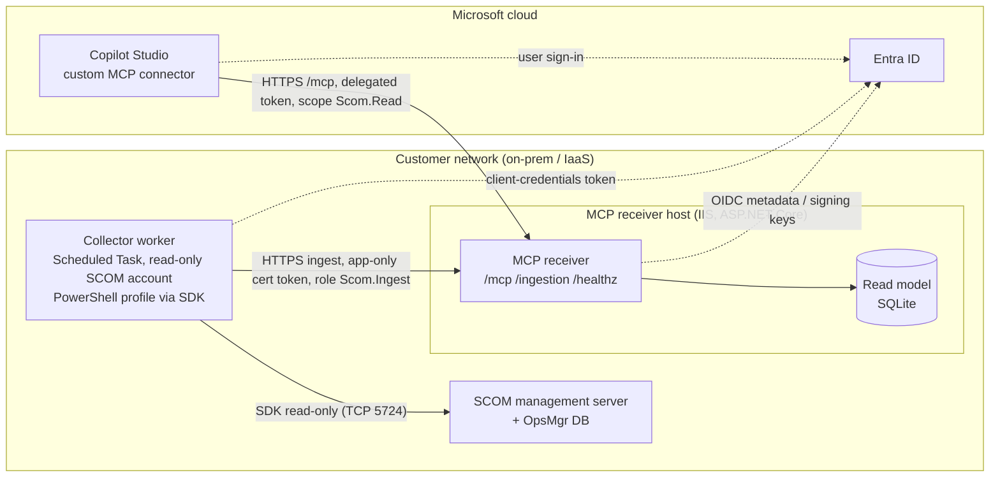

# Architecture

**No component queries SCOM at question time.** A scheduled collector reads SCOM,
publishes a bounded snapshot to the receiver, and every Copilot Studio question is
answered from that retained snapshot.

## Components

| Component | Runs as | Reads | Writes | Ports | Identity |
|---|---|---|---|---|---|
| SCOM management group | SCOM services | Agents | OpsMgr DB | SDK service TCP 5724 (see [network-and-ports.md](network-and-ports.md)) | Windows auth |
| Collector worker (`ScomMcp.dll --worker`) | Scheduled task as a dedicated domain user with the SCOM *Read-Only Operator* role | SCOM via the SDK (through a pinned Windows PowerShell profile); its own config | Checkpoint DB, bounded logs, runtime-state directory | Outbound only | Windows account for SCOM; Entra app-only token (certificate) for ingestion |
| MCP receiver | IIS app pool (`ApplicationPoolIdentity`, No Managed Code) | Read-model DB, `appsettings.json` | Read-model DB, bounded logs | Inbound HTTPS 443; outbound HTTPS 443 to Entra | Validates Entra tokens; no SCOM credentials |
| Entra ID | Microsoft | App registrations | Tokens | HTTPS 443 | Issues delegated (reader) and app-only (publisher) tokens |
| Copilot Studio connector | Microsoft cloud | Receiver `/mcp` | n/a | Outbound HTTPS 443 from Power Platform | Delegated user token, scope `Scom.Read` |

## Data flow

1. On the configured interval the worker starts one collection attempt.
2. The worker's PowerShell profile reads the approved scope from SCOM through the
   SDK, read-only, and emits one normalized JSON scan; the worker checks it.
3. The worker obtains an app-only Entra token (certificate assertion, resource
   `api://<API_APP_ID>`) and publishes the dataset over HTTPS to `/ingestion`.
4. The receiver validates tenant, audience, `Scom.Ingest` role and the approved
   publisher object ID, stages the batches, and commits the dataset to its
   read model. The worker records an acknowledgement checkpoint.
5. A user asks Copilot Studio a question. The agent calls a tool on the custom
   connector, which sends the user's delegated token (scope `Scom.Read`) to `/mcp`.
6. The receiver validates the token (`tid`, `aud`, `scp`, caller `oid`) and answers
   from the retained snapshot, with `collected_at`, coverage and freshness.

The agent therefore never touches SCOM, and query-time load on SCOM is zero.
See [security.md](security.md) and [limitations.md](limitations.md) for what this does
and does not guarantee.
