# Deployment guide

An end-to-end, numbered walkthrough from an empty server to a Copilot Studio agent that
answers SCOM inventory questions. Every value you create is given a name, recorded once in
the [values register](#values-register), and referenced later as **(from Step N)**, so you
always know which value goes where.

> Unsigned community release, lab-validated on a 3-server Windows Server 2022/2025 lab,
> not production-certified. Whole-management-group scope is validated on 3 servers only;
> start with group scope ([sizing-and-scope](sizing-and-scope.md)).

This guide stitches together the reference pages; it does not replace them. Follow it in
order, and open the linked page when you need detail.

## Contents

- [What you will build](#what-you-will-build)
- [Before you start](#before-you-start)
- [Values register](#values-register)
- [Step 1. Download and verify the package](#step-1-download-and-verify-the-package)
- [Step 2. Prepare the host: DNS, TLS, IIS, network](#step-2-prepare-the-host-dns-tls-iis-network)
- [Step 3. Prepare SCOM and the worker account](#step-3-prepare-scom-and-the-worker-account)
- [Step 4. Create the publisher certificate](#step-4-create-the-publisher-certificate)
- [Step 5. Create the three Entra app registrations](#step-5-create-the-three-entra-app-registrations)
- [Step 6. Write the configuration files](#step-6-write-the-configuration-files)
  - [6e. Attest the source evidence](#6e-attest-the-source-evidence)
  - [6f. Confirm windowsMapping for your management packs](#6f-confirm-windowsmapping-for-your-management-packs)
- [Step 7. Run setup: Prepare to Host Publish](#step-7-run-setup-prepare-to-host-publish)
- [Step 8. Connect Copilot Studio](#step-8-connect-copilot-studio)
- [Step 9. Acceptance checks and Accept](#step-9-acceptance-checks-and-accept)
- [Step 10. Register recurrence](#step-10-register-recurrence)
- [Step 11. Agent acceptance test](#step-11-agent-acceptance-test)
- [Find a value again](#find-a-value-again)
- [Troubleshooting](#troubleshooting)

## What you will build

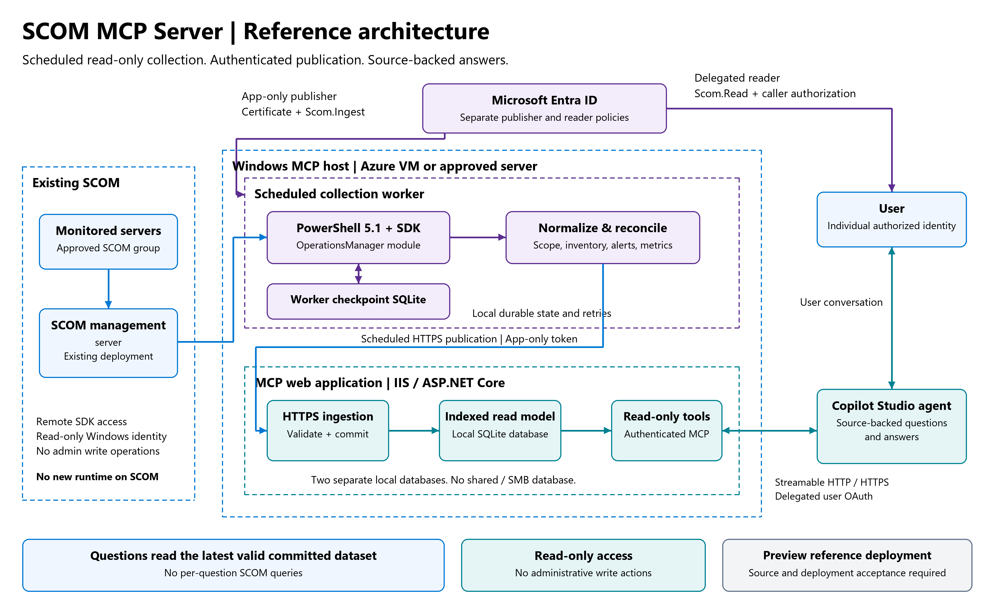

- A **collector worker** (scheduled task, read-only account) reads SCOM through the
  OperationsManager SDK and publishes a snapshot over HTTPS with an app-only certificate token.
- An **MCP receiver** (IIS, ASP.NET Core) validates and stores the snapshot in a local read
  model and serves read-only tools at `https://<FQDN>/mcp`.
- A **Copilot Studio agent** calls those tools with each user's own Entra sign-in. SCOM is
  never queried when a question is asked.
- **Three Entra app registrations** keep the roles apart: API (the resource), Publisher
  (the worker), Reader (Copilot Studio).

Component detail: [architecture](architecture.md). Trust model: [security](security.md).

## Before you start

You need the following. People and roles differ per organization; one person may hold several.

| You need | Why | Used in |
|---|---|---|
| Local administrator on the Windows Server that will host the receiver and worker (Windows PowerShell 5.1, elevated) | Install, IIS, certificates, scheduled task | Steps 1, 2, 4, 7, 9, 10 |
| A DNS name for the server (`<FQDN>`) that resolves to it, **including from the server itself** | HTTPS binding, token audience checks, Activate health check | Steps 2, 6, 7, 8 |
| A TLS certificate for `<FQDN>` trusted by the server and by Copilot Studio (in practice a public-CA certificate, unless a gateway with a public certificate fronts the server) | HTTPS endpoint | Step 2 |
| IIS and the .NET 8 ASP.NET Core Hosting Bundle (install after IIS) | Hosts the receiver | Steps 2, 7 |
| A SCOM management group, a reachable management server and the Operations Manager console or PowerShell module on the collector host | The data source | Steps 3, 6, 7 |
| A dedicated read-only domain account with Allow log on locally and Log on as a batch job | Runs the worker | Steps 3, 4, 7, 10 |
| An Entra tenant where you can register apps (Application Administrator or equivalent) and grant admin consent (or an administrator who can) | Three app registrations | Step 5 |
| Copilot Studio access in the same tenant | The agent | Step 8 |
| The Entra user(s) allowed to ask questions | Caller allow-list | Steps 5, 6, 9 |

**Supported SCOM versions.** Validated: SCOM 2025 (lab SDK assemblies `7.0.5000.0`, file
version `10.25.x`). Expected: SCOM 2019/2022/2025 (same SDK and Windows Library MP; verify with
`New-ScomMappingProfile`). Not supported: SCOM 2016 and earlier (out of Microsoft support);
SCOM Managed Instance untested.

Network: inbound 443 only; the worker reaches the management server on the SDK port.
Details: [network-and-ports](network-and-ports.md).

> **Warning:** Never paste secrets, PFX files or tokens into any file in this repository,
> an issue or a screenshot. The only secret in the whole flow is the reader app's client
> secret, and it is entered only in the Copilot Studio connector.

## Values register

Each row is created in one step and used in later steps. Keep your own copy in a private
note (not in the repository). Where a step says **(from Step N)**, use the value from this
table that Step N created.

| Value | What it is | Created in | Used in |
|---|---|---|---|
| `<FQDN>` | Public host name of the receiver | Step 2 | Steps 6, 8, 9 |
| `<TLS_THUMBPRINT>` | Thumbprint (40 hex) of the TLS certificate for `<FQDN>` | Step 2 | Step 6 |
| `<WORKER_ACCOUNT>` | Worker domain account, `DOMAIN\user` | Step 3 | Steps 4, 6, 7, 10 |
| `<MGMT_SERVER_FQDN>` | A SCOM management server the worker reaches | Step 3 | Step 6 |
| `<MG_ID>` | SCOM management group ID (GUID) | Step 3 | Step 6 |
| `<GROUP_ID>` | SCOM group ID (GUID), for group scope | Step 3 | Step 6 |
| `<OM_MODULE_PATH>` | Full path to the installed `OperationsManager.psd1` | Step 3 | Step 6 |
| `<CERT_THUMBPRINT>` | Thumbprint of the publisher client-auth certificate | Step 4 | Steps 5, 6 |
| `<PUBLISHER_CER_PATH>` | Path to the public `.cer` (no private key) | Step 4 | Step 5 |
| `<TENANT_ID>` | Entra tenant (directory) ID | Step 5 | Steps 6, 8 |
| `<API_APP_ID>` | API app (client) ID; resource is `api://<API_APP_ID>` | Step 5 | Steps 6, 8 |
| `<PUBLISHER_APP_ID>` | Publisher app (client) ID | Step 5 | Step 6 |
| `<PUBLISHER_SP_OBJECT_ID>` | Object ID of the publisher **Enterprise application** (service principal) | Step 5 | Step 6 |
| `<READER_APP_ID>` | Reader app (client) ID | Step 5 | Steps 6, 8 |
| Reader client secret | Credential for the reader app | Step 5 | Step 8 only (never in a file) |
| `<READER_USER_OBJECT_ID>` | Object ID of each allowed **user** | Step 5 | Step 6 |
| `<CALLBACK_URI>` | Redirect URI Copilot Studio shows for the connector | Step 8 | Step 8 (added to the reader app) |

Config-file mapping for these values: [entra-setup, where each value lands](entra-setup.md#where-each-value-lands).

## Step 1. Download and verify the package

1. Download `scom-mcp-<RELEASE>.zip` and its `.sha256` from the
   [Releases page](https://github.com/AhmedElshawa/scom-mcp-server/releases) into an empty folder.
   Use the latest pre-release from the Releases page (v0.2.1-lab at the time of writing) and
   substitute its tag for `<RELEASE>` in the commands below.
2. Verify the download (PowerShell prints `True` when the hash matches):

   ```powershell
   (Get-Content .\scom-mcp-<RELEASE>.zip.sha256) -match (Get-FileHash .\scom-mcp-<RELEASE>.zip).Hash
   gh attestation verify .\scom-mcp-<RELEASE>.zip --repo AhmedElshawa/scom-mcp-server
   ```

3. Extract it and place the extracted folder at `C:\ScomMcp\package` (the folder that
   contains `setup\`, `server\`, `examples\` and `docs\`). This guide calls it `<pkg>`:

   ```powershell
   New-Item -ItemType Directory C:\ScomMcp -Force | Out-Null
   Expand-Archive .\scom-mcp-<RELEASE>.zip -DestinationPath C:\ScomMcp\_extract
   Move-Item (Get-ChildItem C:\ScomMcp\_extract -Directory).FullName C:\ScomMcp\package
   Remove-Item C:\ScomMcp\_extract
   ```

> **Note:** The package is unsigned. If your PowerShell execution policy requires signed
> scripts, see [local-evaluation-signing](local-evaluation-signing.md). Documentation on
> `main` may be newer than the ZIP; the code is identical.

At this point you should have: `<pkg>` with `setup\Start-ScomSetup.ps1` inside it.

## Step 2. Prepare the host: DNS, TLS, IIS, network

1. **DNS.** Create a record for `<FQDN>` and make sure the server itself resolves it
   (`Resolve-DnsName <FQDN>`). Step 7's Activate fails if it cannot, and the failure is hard
   to undo ([install-cli failure notes](install-cli.md#failure-notes)).
2. **TLS certificate.** Install a certificate whose subject or SAN is `<FQDN>` in
   `LocalMachine\My`, issued by a CA trusted by the server and by Copilot Studio. In practice
   a certificate from a public CA is required unless a gateway that presents a public
   certificate fronts the server. Record its thumbprint:

   ```powershell
   Get-ChildItem Cert:\LocalMachine\My | Where-Object Subject -like '*<FQDN>*' |
     Select-Object Subject, Thumbprint, NotAfter
   ```

3. **IIS and the Hosting Bundle.** Install the Web Server (IIS) role, then the .NET 8
   ASP.NET Core Hosting Bundle (in that order). Setup creates the site, pool and HTTPS
   binding for you in Step 7; do not create them by hand.
4. **Network.** Allow inbound TCP 443 from the Power Platform service tags
   `AzureConnectors` and `PowerPlatformPlugins` (use the regionless tags). Allow outbound
   443 to `login.microsoftonline.com` and the worker's path to the management server.
   Rule examples (NSG and Windows Firewall): [network-and-ports](network-and-ports.md).

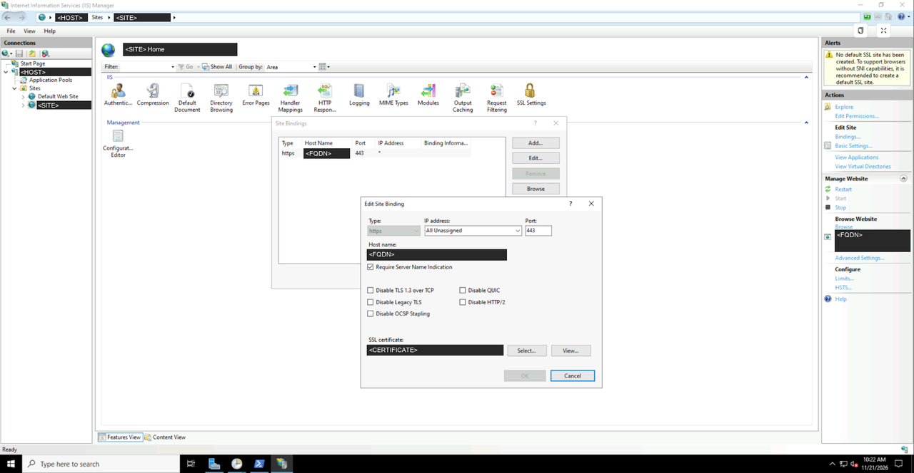

*The HTTPS binding that setup creates: port 443 with Require Server Name Indication ticked (identifiers redacted).*

**Record these values:** `<FQDN>`, `<TLS_THUMBPRINT>` (40 hex characters, no spaces).

## Step 3. Prepare SCOM and the worker account

1. **Create the worker account** (`<WORKER_ACCOUNT>`): a domain user, not a SCOM
   administrator. Add it to the **Read-Only Operator** user role in SCOM, scoped to the
   monitored objects. On the collector host grant **Allow log on locally** and
   **Log on as a batch job**. The full rights table is in
   [service-accounts](service-accounts.md).
2. **Gather SCOM facts** on the collector host (console or PowerShell module installed).
   Prefer a non-primary management server for `<MGMT_SERVER_FQDN>`; if the first server
   returned below is the primary, use another one's name instead:

   ```powershell
   Import-Module OperationsManager
   (Get-Module -ListAvailable OperationsManager | Select-Object -First 1).Path   # <OM_MODULE_PATH>
   (Get-SCOMManagementGroup).Id                                                  # <MG_ID>
   (Get-SCOMManagementServer | Select-Object -First 1).DisplayName               # <MGMT_SERVER_FQDN>
   (Get-SCOMGroup -DisplayName '<GROUP_DISPLAY_NAME>').Id                        # <GROUP_ID>
   ```

3. **Choose the scope.** Start with **group scope**: create or pick a SCOM group that
   contains only the Windows computers you want and use its ID as `<GROUP_ID>`. Whole
   management group is possible but validated on 3 servers only
   ([sizing-and-scope](sizing-and-scope.md)).

At this point you should have these values written down (from Step 3):

1. `<WORKER_ACCOUNT>`, a domain account in the SCOM Read-Only Operator role with Allow log
   on locally and Log on as a batch job on the collector host
2. `<MGMT_SERVER_FQDN>`
3. `<MG_ID>` (a GUID)
4. `<GROUP_ID>` (a GUID; for group scope)
5. `<OM_MODULE_PATH>` (ends in `OperationsManager.psd1`)

## Step 4. Create the publisher certificate

The worker proves its identity to the receiver with a client-authentication certificate, not
a secret. Create it on the collector host (elevated Windows PowerShell 5.1). This is not the
TLS certificate and not a code-signing certificate.

```powershell
$subject    = 'CN=scom-mcp-publisher'
$publicFile = 'C:\ScomMcp\scom-mcp-publisher.cer'
$cert = New-SelfSignedCertificate -Type Custom -Subject $subject `
  -CertStoreLocation 'Cert:\LocalMachine\My' `
  -Provider 'Microsoft Software Key Storage Provider' -KeyAlgorithm RSA -KeyLength 2048 `
  -HashAlgorithm SHA256 -KeyUsage DigitalSignature -KeyExportPolicy NonExportable `
  -NotAfter (Get-Date).AddYears(1)
$cert | Select-Object Subject, Thumbprint, NotAfter
Export-Certificate -Cert $cert -FilePath $publicFile -Type CERT -NoClobber
```

Then give `<WORKER_ACCOUNT>` (from Step 3) **Read** on the certificate's private key
(Certificates MMC > Local Computer > Personal > the certificate > All Tasks > Manage Private
Keys). Notes on reuse, renewal and enterprise-CA alternatives:
[guided-setup](guided-setup.md#publisher-identity-and-certificate-reuse-or-create).

> **Warning:** Upload only the public `.cer` to Entra. Never export or upload a private key
> or PFX. The certificate expires after one year; plan renewal.

At this point you should have (from Step 4):

1. `<CERT_THUMBPRINT>`: a 40-hex thumbprint of a certificate in `Cert:\LocalMachine\My` with
   a non-exportable private key that `<WORKER_ACCOUNT>` can read
2. `<PUBLISHER_CER_PATH>`: the public `C:\ScomMcp\scom-mcp-publisher.cer` (no private key)

## Step 5. Create the three Entra app registrations

Choose one route; both produce the same result.

- **Route A (script, recommended).** From `<pkg>`, as an administrator signed in to
  Microsoft Graph PowerShell. Sign in first (install `Microsoft.Graph.Authentication` if
  prompted). The signed-in account needs a role that can create app registrations and grant
  admin consent to a non-Microsoft-Graph API: Application Administrator, Cloud Application
  Administrator, Privileged Role Administrator or Global Administrator:

  ```powershell
  Connect-MgGraph -TenantId <TENANT_ID> -Scopes 'Application.ReadWrite.All','AppRoleAssignment.ReadWrite.All'
  .\setup\Provision-ScomEntra.ps1 -TenantId <TENANT_ID> -NamePrefix scom-mcp `
    -PublicCertificatePath <PUBLISHER_CER_PATH> `
    -StateDirectory C:\ScomMcp\config -GrantPublisherRole
  ```

  Use `<PUBLISHER_CER_PATH>` (from Step 4). `<TENANT_ID>` is on Entra admin center >
  Overview. The script creates or verifies all three registrations, sets
  `requestedAccessTokenVersion` to `2` on the API app, and writes a nonsecret
  `identity.json` into `C:\ScomMcp\config`; open that file to read the app IDs. Details and
  prerequisites: [entra-setup, Route A](entra-setup.md#route-a-script).
- **Route B (portal).** Follow [entra-setup, Route B](entra-setup.md#route-b-portal).
  Upload the `.cer` from `<PUBLISHER_CER_PATH>` (from Step 4) to the publisher app.
  **You must also set `requestedAccessTokenVersion` to `2` on the API app:** Entra admin
  center > App registrations > the API app > Manifest > set
  `"requestedAccessTokenVersion": 2` (under `api` in the Microsoft Graph app manifest; the
  older AAD Graph manifest shows it as `accessTokenAcceptedVersion`) > Save. With the
  default the token's `aud` is `api://<API_APP_ID>` instead of the GUID `<API_APP_ID>` that
  `Auth.Audiences` expects, so every call returns 401.

Either way you also need to:

1. **Create the reader client secret** through your approved credential process. Keep it
   for Step 8; do not write it to a file.
2. **Record the publisher's Enterprise application Object ID** (the service principal, not
   the app registration). In the same Graph session:
   `(Get-MgServicePrincipal -Filter "appId eq '<PUBLISHER_APP_ID>'").Id`
   (reading service principals may also need the `Application.Read.All` scope; or read it
   in Entra > Enterprise applications > the publisher > Object ID).
3. **Record the Object ID of each user** allowed to ask questions (Entra > Users).
4. **Grant admin consent for the reader app.** The `Scom.Read` scope is admin-only, so
   consent is required once for the tenant. Click path, signed in with one of the roles
   above: Entra admin center >
   **Entra ID** > **App registrations** > **All applications** > the reader app
   (`<READER_APP_ID>`) > **API permissions** > confirm `Scom.Read` (Delegated) is listed
   (use **Add a permission** > **My APIs** > the API > **Delegated permissions** > `Scom.Read`
   if it is not) > **Grant admin consent for `<your tenant>`** > **Yes**. The Status column must
   show **Granted for `<your tenant>`**.
5. **Confirm the publisher's consent** the same way: the publisher app > API permissions >
   `Scom.Ingest` (Application) must show **Granted for `<your tenant>`**.

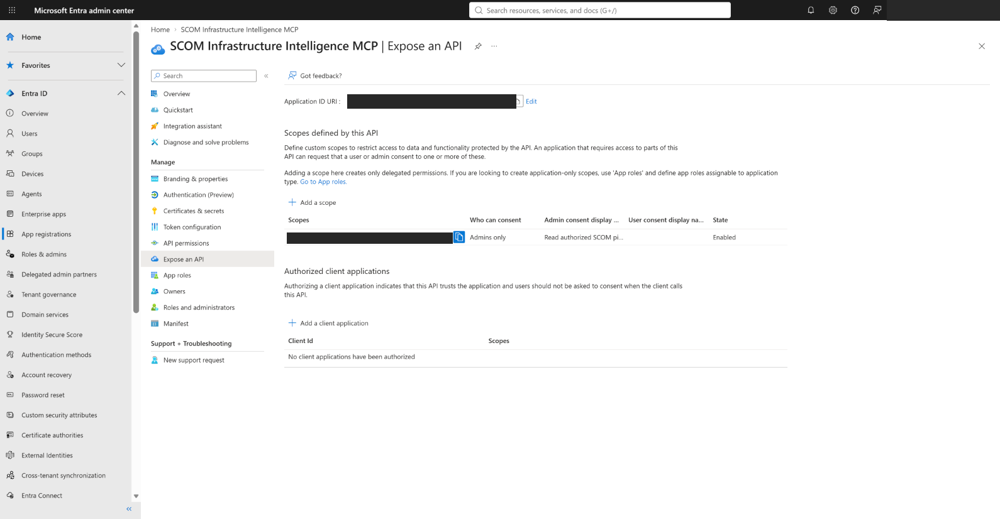

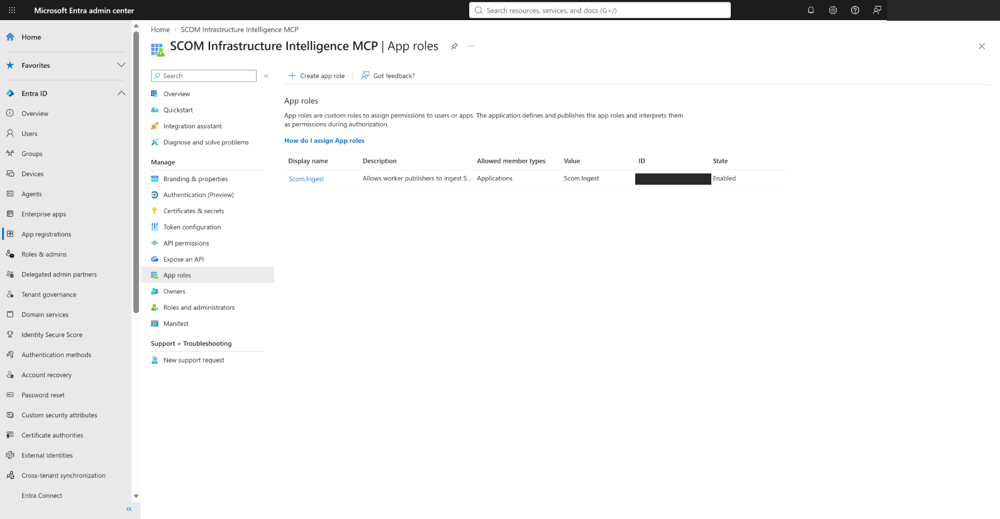

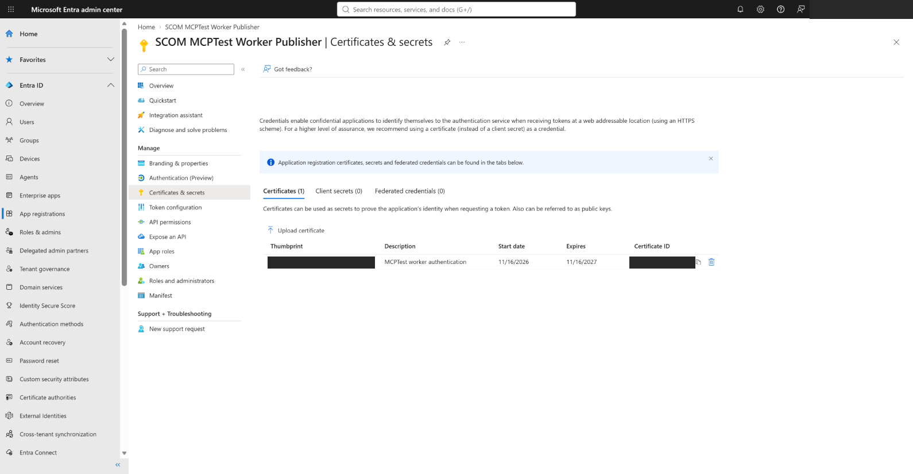

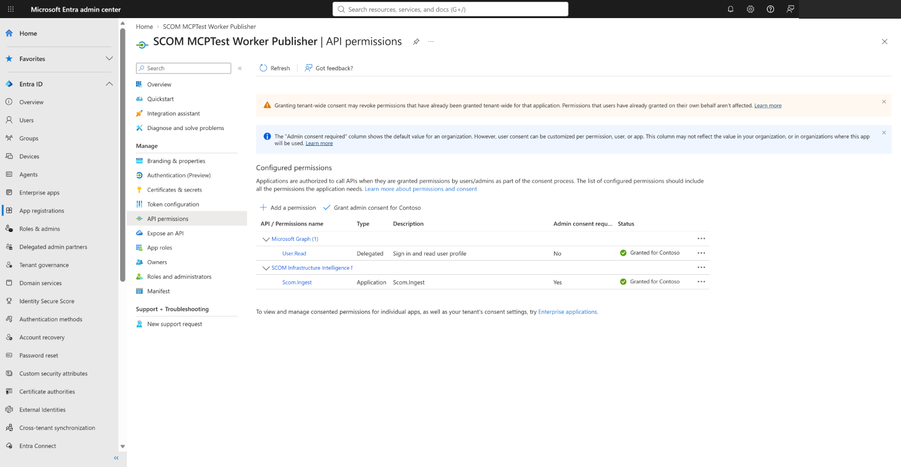

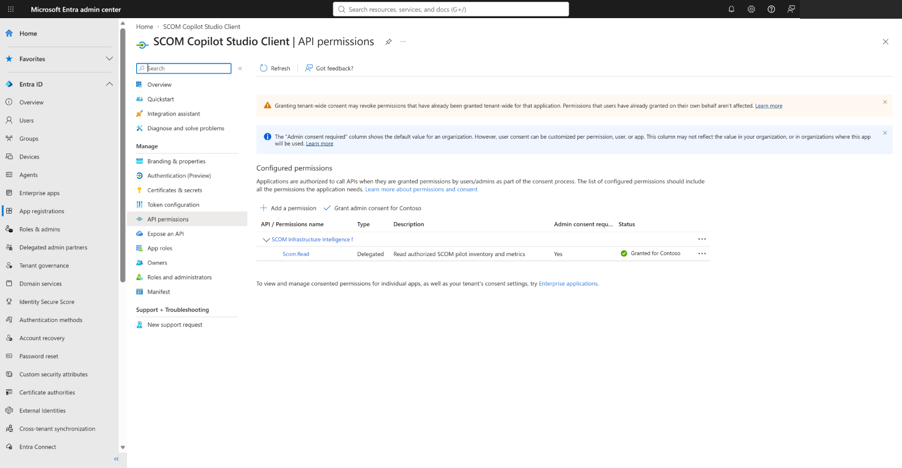

At this point you should have these values:

1. `<TENANT_ID>`
2. `<API_APP_ID>` (the API's Application ID URI is `api://<API_APP_ID>`)
3. `<PUBLISHER_APP_ID>`
4. `<PUBLISHER_SP_OBJECT_ID>`
5. `<READER_APP_ID>`
6. The reader client secret (keep it private; used in Step 8)
7. `<READER_USER_OBJECT_ID>` for each allowed user

Do not request Microsoft Graph permissions for any of these apps. If you do not have these
values, see [Find a value again](#find-a-value-again).

## Step 6. Write the configuration files

You now have everything needed to write four files. Start from the examples in
`<pkg>\examples\` and replace every `<PLACEHOLDER>`. Keep them in a staging folder (`C:\ScomMcp\config`, never the repository); Configure in
Step 7 copies them into the private folder.

### 6a. `identity.json`

Route A already wrote this. For Route B, copy
[`identity.example.json`](../examples/identity.example.json) and fill it:

| Field | Value |
|---|---|
| `tenantId` | `<TENANT_ID>` (from Step 5) |
| `apiClientId`, and `resource` as `api://<API_APP_ID>` | `<API_APP_ID>` (from Step 5) |
| `publisherClientId` | `<PUBLISHER_APP_ID>` (from Step 5) |
| `publisherObjectId` | `<PUBLISHER_SP_OBJECT_ID>` (from Step 5) |
| `readerClientId` | `<READER_APP_ID>` (from Step 5) |
| `certificateThumbprint` | `<CERT_THUMBPRINT>` (from Step 4) |

### 6b. `receiver.json`

Start from [`receiver.example.json`](../examples/receiver.example.json); field notes in
[`receiver.example.md`](../examples/receiver.example.md).

| Setting | Value |
|---|---|
| `Auth.TenantId` | `<TENANT_ID>` (from Step 5) |
| `Auth.Audiences` | `<API_APP_ID>` (from Step 5); verify it equals the `aud` of a real token |
| `Auth.Callers[].ObjectId` | `<READER_USER_OBJECT_ID>`, one entry per allowed user (from Step 5) |
| `ReadModel.PublisherObjectIds` | `<PUBLISHER_SP_OBJECT_ID>` (from Step 5) |
| `ReadModel.ManagementGroupId` / `GroupId` | `<MG_ID>` / `<GROUP_ID>` (from Step 3) |
| `ReadModel.AllowedPropertiesByClass` | The same classes and properties as the worker's `allowedPropertiesByClass`; copy them from the generator summary in 6c |
| `AllowedHosts` | `<FQDN>` (from Step 2) |

### 6c. `worker.json`

Start from [`worker.example.json`](../examples/worker.example.json); field notes in
[`worker.example.md`](../examples/worker.example.md).

| Setting | Value |
|---|---|
| `identity.tenantId` | `<TENANT_ID>` (from Step 5) |
| `identity.clientId` | `<PUBLISHER_APP_ID>` (from Step 5) |
| `identity.resource` | `api://<API_APP_ID>` (from Step 5) |
| `identity.certificateThumbprint` | `<CERT_THUMBPRINT>` (from Step 4) |
| `publisher.endpoint` | `https://<FQDN>` (from Step 2) |
| `profile.configuration.managementServer`, `managementGroupId`, `groupId` | `<MGMT_SERVER_FQDN>`, `<MG_ID>`, `<GROUP_ID>` (from Step 3) |
| `profile.configuration.operationsManagerModule` | `<OM_MODULE_PATH>` (from Step 3); must equal the plan's value in 6d |
| `schedule.interval` | `01:00:00` (default). The receiver's `Source.FreshMinutes` must exceed it |
| `profile.configuration.windowsMapping`, `allowedPropertiesByClass`, `additionalRelationshipNames` | Generated from your SCOM by `New-ScomMappingProfile.ps1` (below); do not hand-edit |
| Verification flags (six) | All six set to `true` by `Approve-ScomMappingProfile.ps1` (below), in either scope, after you review the evidence. `wholeManagementGroupApproved` is not one of the six: the generator sets it from `-ScopeKind` |

Setup's Configure step supplies the script path and hash, state paths and some identity
fields while merging ([worker.example.md](../examples/worker.example.md)); still fill in the
values above so the file can be reviewed before you run it.

The generated worker.json is a staging input for Configure (Step 7), which fills identity, endpoint, script hash and paths; do not run --validate-setup on it directly.

The generator also writes `profile.configuration.relationshipReadMode` (`set` whenever it observed both the OS and disk hosting relationships, including when non-disk devices share the disk relationship because the reader skips and counts them; otherwise `perSource`) and records the choice and its reason in `worker.json.evidence.json`; `set` was lab-validated on SCOM 2025 (identical inventory to `perSource`, 2 SDK calls instead of 22), and you may set it to `perSource` before Configure ([sizing-and-scope.md](sizing-and-scope.md)).

**Generate the mapping, review it, approve it.** The generator reads your SCOM read-only,
works out the class, relationship and property names and the memory and disk units, and writes
a complete `worker.json` with all six verification flags `false`. Run it as `<WORKER_ACCOUNT>`
in Windows PowerShell 5.1 from `<pkg>`, on a host that has the Operations Manager console or
PowerShell module. The worker account needs write access to the output folder while it runs
(create `C:\ScomMcp\worker-draft` and grant it Modify):

```powershell
.\setup\New-ScomMappingProfile.ps1 -ManagementServer '<MGMT_SERVER_FQDN>' -ScopeKind group -GroupId '<GROUP_ID>' -SampleComputers 3 -OutputPath C:\ScomMcp\worker-draft\worker.json
```

For whole-management-group scope use `-ScopeKind managementGroup` and omit `-GroupId`
(validated on 3 servers only). Optional parameters: `-OperationsManagerModule <OM_MODULE_PATH>`
if the module is not in the default location, `-WorkerTemplatePath` for another template
(default `..\examples\worker.example.json`), `-DeadlineSeconds` (default 120) and `-Force` to
overwrite earlier output. The script samples at most 10 computers, does one relationship read
per computer and stops at the local deadline; these bounds limit local consumption only and
do not bound work inside SCOM.

It writes three outputs next to each other: `worker.json`, `worker.json.evidence.json` (everything it
observed) and a printed summary. Exit codes: `0` ready for review; `1` bad arguments or
existing output; `2` no computers in scope, the module is missing or discovery failed (nothing
written); `3` the memory or disk unit could not be proven (the file carries `null` units and
cannot be approved); `4` the mapping is ambiguous, for example disks hosted by both relationships
(only the evidence file is written). On `3` or `4` use the manual path in 6e and 6f. The
generator never guesses a unit.

**Review the summary.** Check that the computers sampled are the ones you expect, that the
memory and disk units match what you know about one of those servers, and that the listed
classes are the most-derived classes for your management packs. Copy the printed
`allowedPropertiesByClass` into the receiver's `ReadModel.AllowedPropertiesByClass` in
`receiver.json` (6b): the two must be identical.

**Approve.** This prints the evidence again, refuses if the file no longer matches it, asks for
one `APPROVE`, sets exactly the six flags to `true` and writes `worker.json.attestation.txt`
(operator, UTC date, SHA-256 of the evidence file). It sets all six regardless of scope: the
collector enforces only the flags that apply to your scope (group: `membershipQueryContractVerified`;
whole management group: `enumerationQueryContractVerified` plus `wholeManagementGroupApproved`),
so the other scope's flag is set but not enforced. It changes nothing else, including
`wholeManagementGroupApproved` and `liveChecks.queryContractVerified`:

```powershell
.\setup\Approve-ScomMappingProfile.ps1 -WorkerPath C:\ScomMcp\worker-draft\worker.json
```

Expected last line: `Result: APPROVED. Next: fill the identity fields, then run the setup Configure step.`

Finally, copy the three files together to `C:\ScomMcp\config` (keep the names), and fill in
the `identity`, `publisher` and remaining placeholder values in the table above in
`C:\ScomMcp\config\worker.json`. Approval is your attestation: the SCOM SDK does not prove it,
so review the summary before you type `APPROVE`. The flags must be `true` before Activate and
Publish will proceed (Step 7, command 5). To do the same checks by hand, use the advanced
path in [6e](#6e-attest-the-source-evidence) and [6f](#6f-confirm-windowsmapping-for-your-management-packs).

### 6d. `setup-plan.json` (the plan input)

This tells setup where to install and what to bind. Save it as `C:\ScomMcp\plan-input.json`:

```json
{
  "schemaVersion": 1,
  "packagePath": "C:\\ScomMcp\\package",
  "installPath": "C:\\ScomMcp\\install",
  "privatePath": "C:\\ScomMcp\\private",
  "receiverStatePath": "C:\\ScomMcp\\receiver-state",
  "workerStatePath": "C:\\ScomMcp\\worker-state",
  "mcpLogPath": "C:\\ScomMcp\\logs\\mcp",
  "collectorLogPath": "C:\\ScomMcp\\logs\\collector",
  "siteName": "ScomMcp",
  "poolName": "ScomMcpPool",
  "applicationPath": "/",
  "httpsBaseUrl": "https://<FQDN>",
  "tlsThumbprint": "<TLS_THUMBPRINT>",
  "scopeKind": "group",
  "wholeManagementGroupApproved": false,
  "managementGroupId": "<MG_ID>",
  "groupId": "<GROUP_ID>",
  "managementServer": "<MGMT_SERVER_FQDN>",
  "workerAccount": "<WORKER_ACCOUNT>",
  "operationsManagerModule": "<OM_MODULE_PATH>"
}
```

| Field | Value or rule |
|---|---|
| `packagePath` | Where you placed `<pkg>` in Step 1 |
| `httpsBaseUrl` | `https://<FQDN>` (from Step 2); the path must equal `applicationPath` |
| `tlsThumbprint` | `<TLS_THUMBPRINT>` (from Step 2) |
| `managementGroupId`, `groupId`, `managementServer` | From Step 3 |
| `workerAccount` | `<WORKER_ACCOUNT>` (from Step 3); must not be `IIS APPPOOL\<poolName>` |
| `operationsManagerModule` | `<OM_MODULE_PATH>` (from Step 3) |
| Paths | Seven distinct folders on local NTFS, none inside another or under `%WINDIR%`; the parent of `installPath` must already exist |
| Whole-management-group scope | `scopeKind` = `managementGroup`, `wholeManagementGroupApproved` = `true`, `groupId` = `null`. Validated on 3 servers only |

### 6e. Attest the source evidence

**Advanced / manual path.** Most readers skip 6e and 6f: `Approve-ScomMappingProfile.ps1` in [6c](#6c-workerjson) already
sets these flags after you review the generator's evidence. Use this section if the generator
exited `3` or `4`, or your change process requires you to inspect the evidence yourself.

The collector will not read SCOM until you attest that you checked the source. The attestations
are six boolean flags in `C:\ScomMcp\config\worker.json` (under `profile.configuration`). They
ship as `false`. A flag is **your statement** that you inspected the evidence in the right-hand
column; it is not measured by the software. Never set one to make a check pass.

| Flag | What it declares | What to inspect |
|---|---|---|
| `windowsMapping.verified` | The class, relationship and property names and the unit factors in `windowsMapping` are right for your management packs | The three facts in [6f](#6f-confirm-windowsmapping-for-your-management-packs) |
| `windowsMapping.agentMonitoringVerified` | The in-scope computers are agent-monitored, so health comes from the agent (no monitoring-role mapping is needed) | Operations console > Administration > Device Management > **Agent Managed** lists every in-scope computer; or `Get-SCOMAgent` |
| `scopeVisibilityVerified` | The worker account sees the scope you intend (the group, or the whole management group) | Step 7 command 3 output, and the same group or inventory visible to `<WORKER_ACCOUNT>` in the console |
| `membershipQueryContractVerified` | **Group scope only.** Group membership returns the computers you expect | The group's members in the console equal the members from the SDK (`Get-SCOMGroup -Id '<GROUP_ID>'` then its related objects) |
| `enumerationQueryContractVerified` | **Whole-management-group scope only.** Enumerating all instances of the Windows classes returns what you expect | Instance counts from `Get-SCOMClassInstance -Class <class>` equal the console's Discovered Inventory counts |
| `additionalRelationshipContractVerified` | Both names in `additionalRelationshipNames` exist and return edges | The relationship probe in 6f |

What to set by hand (the generator path in 6c sets all six, so this is the same outcome):

- **Group scope:** the five flags that apply are everything except
  `enumerationQueryContractVerified`. The collector does not check the enumeration flag in
  group scope, so it may be `false` (by hand) or `true` (after Approve).
- **Whole management group:** the five flags that apply are everything except
  `membershipQueryContractVerified`, which the collector does not check in this scope (`false`
  by hand, `true` after Approve). Also set `wholeManagementGroupApproved` to `true` in both
  `worker.json` and the plan (6d), and leave `groupId` as `null`. Validated on 3 servers only.
- `liveChecks.queryContractVerified` stays `false` in every case.

When they are enforced: Configure (command 4) only validates that the JSON is well-formed and
consistent, so set the flags **before** running it or Configure will report the file as
changed. Activate (command 5) and every later command run `--validate-setup`, which exits with
`SCOM_SETUP_SOURCE_EVIDENCE_REQUIRED` and blocks the step until the flags are `true`. The
collector enforces them again on every run (for example `SCOM_WINDOWS_MAPPING_UNVERIFIED`,
`SCOM_PROFILE_SCOPE_UNVERIFIED`, `SCOM_PROFILE_GRAPH_CONTRACT_UNVERIFIED`).

Record the decision once, in your change ticket or the deployment notes (get the hash with
`Get-FileHash C:\ScomMcp\config\worker.json`):

```text
Attested <YYYY-MM-DD> by <NAME>: set <flag list> = true for <group|managementGroup> scope after reviewing <evidence list>; worker.json SHA-256 <HASH>.
```

### 6f. Confirm windowsMapping for your management packs

**Advanced / manual path.** `New-ScomMappingProfile.ps1` (6c) performs these checks for you. Use this section to verify its
result independently, or to build the mapping by hand when the generator cannot prove a unit.

The example's class, relationship and property names are candidates from a Windows Server
2022 lab, not guarantees. Confirm three facts for your management packs before you set
`windowsMapping.verified`. These probes are read-only SDK queries; run them as
`<WORKER_ACCOUNT>` in Windows PowerShell 5.1 (they were not run verbatim in the lab: adjust
if your module version differs).

```powershell
Import-Module '<OM_MODULE_PATH>'
New-SCOMManagementGroupConnection -ComputerName '<MGMT_SERVER_FQDN>'
```

**Fact 1: the classes and relationships exist, and which disk relationship applies.** The
example uses `Microsoft.Windows.Computer`, `Microsoft.Windows.OperatingSystem` and
`Microsoft.Windows.Server.LogicalDisk` as `computerClassName`, `operatingSystemClassName` and
`volumeClassName` (the generator copies them from the template), with
`Microsoft.Windows.ComputerHostsOperatingSystem` and
`Microsoft.Windows.ComputerHostsLogicalDevice`. These are base classes: the collector only
requires that each configured name is an existing class that the observed objects are
instances of, while the allow-list in Fact 3 uses the most-derived classes. For disks the chain
is `Microsoft.Windows.Server.10.0.LogicalDisk` > `Microsoft.Windows.Server.LogicalDisk` >
`Microsoft.Windows.LogicalDisk`; only `Microsoft.Windows.Server.LogicalDisk` was validated in the lab.
Use the direct computer-to-device edge **or**
`osHostsVolumeRelationship`, never both, and list each relationship in
`additionalRelationshipNames`.

```powershell
Get-SCOMClass -Name 'Microsoft.Windows.Computer','Microsoft.Windows.OperatingSystem','Microsoft.Windows.Server.LogicalDisk' |
    Select-Object Name, DisplayName
Get-SCRelationship -Name 'Microsoft.Windows.ComputerHostsOperatingSystem','Microsoft.Windows.ComputerHostsLogicalDevice' |
    Select-Object Name
```

Every name must be returned. A missing name means that class or relationship is not in your
management packs; choose the one your packs define.

Then confirm the relationships exist **on a real in-scope computer**, not only in the
management pack. Pick one monitored computer and list the relationship types that start at it
and at its operating system:

```powershell
$computer = Get-SCOMClassInstance -Class (Get-SCOMClass -Name 'Microsoft.Windows.Computer') |
    Where-Object DisplayName -eq '<SERVER_FQDN>'
$os = Get-SCOMClassInstance -Class (Get-SCOMClass -Name 'Microsoft.Windows.OperatingSystem') |
    Where-Object { $_.Path -eq $computer.DisplayName } | Select-Object -First 1
foreach ($source in $computer, $os) {
    Get-SCOMRelationshipInstance -SourceInstance $source |
        Select-Object @{n='Relationship';e={$_.RelationshipId}}, @{n='Target';e={$_.TargetObject.DisplayName}}
}
```

You should see the computer-to-OS edge and the computer-to-disk (or OS-to-volume) edges for
that server. If the disk edges appear under a different relationship than the one in your
`windowsMapping`, use the one that appears. `RelationshipId` is a GUID; resolve it to a name
with `Get-SCRelationship -Id '<GUID>' | Select-Object Name`.

**Fact 2: the property names and their units.** Read one known server and compare. The
properties used are `PrincipalName`, `OSVersion`, `OSVersionDisplayName` (the OS caption),
`PhysicalMemory`, `LogicalProcessors`, `DeviceID`, `FileSystem` and `SizeInMBs`.

```powershell
$os   = Get-SCOMClassInstance -Class (Get-SCOMClass -Name 'Microsoft.Windows.OperatingSystem') | Select-Object -First 1
$disk = Get-SCOMClassInstance -Class (Get-SCOMClass -Name 'Microsoft.Windows.Server.LogicalDisk') | Select-Object -First 1
$os.Values   | Select-Object @{n='Property';e={$_.Type.Name}}, Value
$disk.Values | Select-Object @{n='Property';e={$_.Type.Name}}, Value
```

For `memoryToMiB` and `volumeSizeToMiB`, pick a server whose real RAM and disk size you know
and compute factor = real MiB / raw value. In the lab, `PhysicalMemory` was in KB (factor
`0.0009765625`) although the management pack labels it MB, and `SizeInMBs` was MiB (factor
`1`). Do not assume your packs match.

**Fact 3: the most-derived class names for the allow-lists.** `allowedPropertiesByClass` in
`worker.json` must be keyed by the most-derived class actually returned, and must equal the
receiver's `AllowedPropertiesByClass` (6b).

```powershell
$cls = 'Microsoft.Windows.Computer','Microsoft.Windows.OperatingSystem','Microsoft.Windows.Server.LogicalDisk'
foreach ($c in $cls) {
    Get-SCOMClassInstance -Class (Get-SCOMClass -Name $c) | Select-Object -First 3 |
        ForEach-Object { $_.GetMostDerivedClasses() | Select-Object -ExpandProperty Name }
} | Sort-Object -Unique
```

In the lab these were `Microsoft.Windows.Server.10.0.Full.Computer`,
`Microsoft.Windows.Server.10.0.Full.OperatingSystem` and
`Microsoft.Windows.Server.10.0.LogicalDisk`. Your list may differ, for example with another
Windows Server version: add one key per class returned.

When all three facts hold, set `windowsMapping.verified` and
`additionalRelationshipContractVerified` as described in 6e.

At this point you should have `identity.json`, `receiver.json` and `worker.json` in
`C:\ScomMcp\config` (with the attestation flags `true`: all six from Approve in 6c, or the five that apply to your scope from 6e, and a recorded
decision: `worker.json.attestation.txt` or the 6e template), and `plan-input.json` in
`C:\ScomMcp`. Reference for every setting: [configuration-reference](configuration-reference.md).

## Step 7. Run setup: Prepare to Host Publish

Run these seven commands in order from `<pkg>`, in **Windows PowerShell 5.1**. Stop at the
first command that does not print its expected line. The **Host** lane is an elevated shell
as a local administrator; the **Worker** lane is a separate session running as
`<WORKER_ACCOUNT>` (from Step 3), which must be able to read `<private>\worker.json` (created by command 4, Configure).

In the commands below, `<state>` is a new state directory (for example `C:\ScomMcp\setup-state`),
`<plan-input>` is `C:\ScomMcp\plan-input.json` (from Step 6) and `<private>` is
the plan's `privatePath`, `C:\ScomMcp\private` (from Step 6).

Every command except the first shows what it is about to do and waits at an approval prompt
ending in "Type APPROVE to perform exactly this action; any other answer cancels". Only the
exact word `APPROVE` proceeds. Read the text before you approve.

### Command 1. Host: initialize the private journal

```powershell
.\setup\Initialize-ScomSetupState.ps1 -Path <state>
```

**APPROVE asks:** create only `<state>` and restrict it to SYSTEM and Administrators for the
deployment journals; no IIS, source, Graph or install actions.
**Expected:** `Private journal directory ready.`

### Command 2. Host: Prepare

```powershell
.\setup\Start-ScomSetup.ps1 -StateDirectory <state> -Step Prepare -PlanPath <plan-input>
```

It prints the preflight lines first; every one must be `PASS`. **APPROVE asks (twice):**
(1) save the private deployment plan and resumable journal, with no host installation yet;
(2) create only the new install, private, receiver-state, worker-state, MCP-log and
collector-log folders from your plan, copy the reviewed package and restrict the ACLs, with
no IIS startup and no source queries.
**Expected:** `Prepared, not active.` followed by a hint to run the worker Connect step, then
`SETUP_STAGE=prepared. No recurrence, metrics or targeted-live enabled.`
**If it fails:** `SETUP_PREREQUISITES_BLOCKED` (fix the failed preflight line) or
`SETUP_EXISTING_PARENT_DIRECTORY_REQUIRED` (create the parent of `installPath`).

### Command 3. Worker: Connect

Sign in to the collector host **as `<WORKER_ACCOUNT>`** and run:

```powershell
.\setup\Start-ScomWorkerSetup.ps1 -PlanPath <private>\setup-plan.json -Step Connect
```

**APPROVE asks:** connect to `<MGMT_SERVER_FQDN>` and check only the management-group identity
and, for group scope, the existing group GUID; 60-second timeout; no members, alerts or
inventory are enumerated and no scope flags are set.
**Expected:** `SCOM_SETUP_CONNECTION_GROUP_VISIBLE_NOT_SCOPE_CERTIFIED` (this is the expected
line for management-group scope too: it proves visibility, not scope certification).

### Command 4. Host: Configure

```powershell
.\setup\Start-ScomSetup.ps1 -StateDirectory <state> -Step Configure `
    -IdentityPath C:\ScomMcp\config\identity.json `
    -ReceiverSettingsPath C:\ScomMcp\config\receiver.json `
    -WorkerSettingsPath C:\ScomMcp\config\worker.json
```

**APPROVE asks:** back up the staged configuration privately and import the reviewed
receiver and worker JSON plus the non-secret identity; setup sets no source-verification flags.
**Expected:** `SETUP_STAGE=configured. No recurrence, metrics or targeted-live enabled.`
**If it fails:** `SETUP_CONFIGURATION_CHANGED_REVIEW_REQUIRED` means a config file changed
after Configure; re-run Configure.

### Command 5. Host: Activate

Before this command the source-evidence flags in `worker.json` must be `true`
([6c](#6c-workerjson) Approve, or [6e](#6e-attest-the-source-evidence)); otherwise it stops with
`SETUP_SOURCE_EVIDENCE_REQUIRED_NO_FLAGS_INFERRED`.

```powershell
.\setup\Start-ScomSetup.ps1 -StateDirectory <state> -Step Activate
```

**APPROVE asks:** create the dedicated pool `<poolName>` and the HTTPS site and application
using `https://<FQDN>`; nothing existing is overwritten; start only this app and enable normal
IIS startup after the HTTPS health check succeeds; on failure stop and disable only its owned pool.
**Expected:** `HTTPS reachable only; inventory and reader acceptance NOT proven.` then
`SETUP_STAGE=activated.`
**If it fails:** a DNS failure gives `SETUP_INTERRUPTED_ACTION_REQUIRES_RECOVERY`; the server
cannot resolve its own `<FQDN>` (Step 2, item 1).

### Command 6. Worker: Publish

As `<WORKER_ACCOUNT>`:

```powershell
.\setup\Start-ScomWorkerSetup.ps1 -PlanPath <private>\setup-plan.json -Step Publish
```

**APPROVE asks:** run one collection, publication and checkpoint attempt for your scope as
`<WORKER_ACCOUNT>`, to `https://<FQDN>`; no recurrence, metrics or live checks.
**Expected:** `SCOM_WORKER_PUBLISHED observed after checkpoint acknowledgement.`
**If it fails:** `SETUP_PUBLICATION_NOT_ACKNOWLEDGED_OR_CONFIGURATION_CHANGED` usually means
a package older than commit `55f3062` (this release includes the fix);
`SETUP_CONFIGURATION_OR_SOURCE_EVIDENCE_BLOCKED` means `--validate-setup` failed, so check the
flags and the mapping (re-run 6c, or see 6e and 6f).

### Command 7. Host: Publish

```powershell
.\setup\Start-ScomSetup.ps1 -StateDirectory <state> -Step Publish
```

**APPROVE asks:** record the worker-reported publication and checkpoint receipt for your
scope; no new source run. A receipt alone is not reader acceptance.
**Expected:** `Publication observed; complete intended-user Studio/tool and unauthorized-user
acceptance before Accept.` then `SETUP_STAGE=published.`

Host-lane commands fail with `SETUP_ADMINISTRATOR_REQUIRED_FOR_HOST_LANE` if the shell is not
elevated. Setup never enables recurrence; that is Step 10. The same sequence is also
documented in the [install-cli runbook](install-cli.md#commands) for depth.

📷 *Wizard screenshots (`wizard-prerequisites.png`, `wizard-configuration.png`) are evaluation: pending; see
[install-wizard](install-wizard.md) and [screenshots/README.md](screenshots/README.md).*

At this point you should have the receiver running at `https://<FQDN>` with one published
dataset, and setup at the `published` stage.

## Step 8. Connect Copilot Studio

Full field list: [copilot-studio-integration](copilot-studio-integration.md#1-create-the-custom-mcp-connector).
In the agent: enable generative orchestration, then **Tools > Add a tool > New tool >
Model Context Protocol** and fill in:

| Field | Value |
|---|---|
| Server URL | `https://<FQDN>/mcp` (from Step 2) |
| Transport | **Streamable HTTP** |
| Authentication | **OAuth 2.0, Manual** |
| Client ID | `<READER_APP_ID>` (from Step 5) |
| Client secret | The reader client secret (from Step 5); entered only here |
| Authorization URL | `https://login.microsoftonline.com/<TENANT_ID>/oauth2/v2.0/authorize` (`<TENANT_ID>` from Step 5) |
| Token URL and Refresh URL | `https://login.microsoftonline.com/<TENANT_ID>/oauth2/v2.0/token` |
| Scopes | `api://<API_APP_ID>/Scom.Read offline_access` (`<API_APP_ID>` from Step 5) |

1. Click **Create** and copy the **callback (redirect) URI** the connector shows
   (`<CALLBACK_URI>`).
2. In Entra, open the **reader** app (`<READER_APP_ID>`, from Step 5) > Authentication >
   add `<CALLBACK_URI>` as a **Web** redirect URI, exactly as shown. Save.
3. Back in Copilot Studio: **Next > Create new connection**, sign in as one of the users
   whose `<READER_USER_OBJECT_ID>` you allow-listed in Step 6, then **Add to agent**. Keep
   individual-user authentication.
4. Paste [`examples/agent-instructions.md`](../examples/agent-instructions.md) verbatim into the
   agent's Instructions.

The connection appears as **Connected** under Copilot Studio's **Manage your connections**:

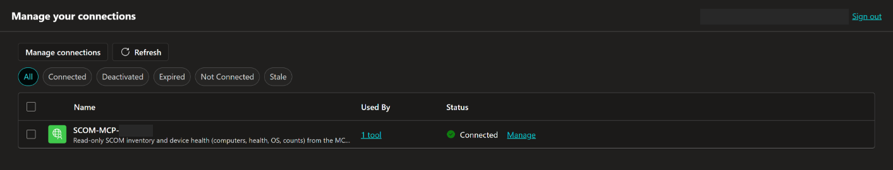

The **Add a Model Context Protocol server** form, with **OAuth 2.0** and **Manual** selected.
Fill in the server URL and the reader app's client ID and secret here; the **Client secret**
field is shown empty (this image shows the form layout, not a configured connector):

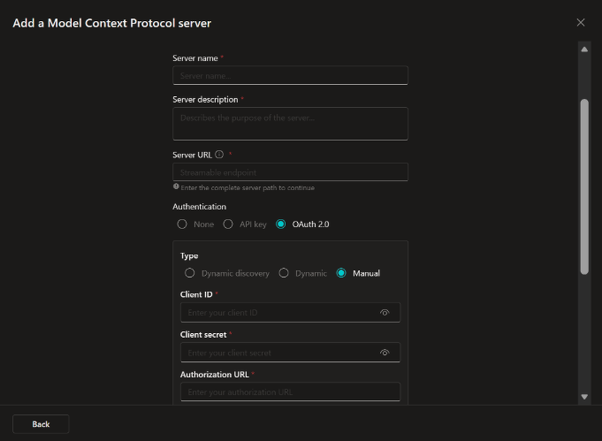

The agent's **Tools** page lists the server's tools with their toggles on (the lab server
exposes 13 read-only tools):

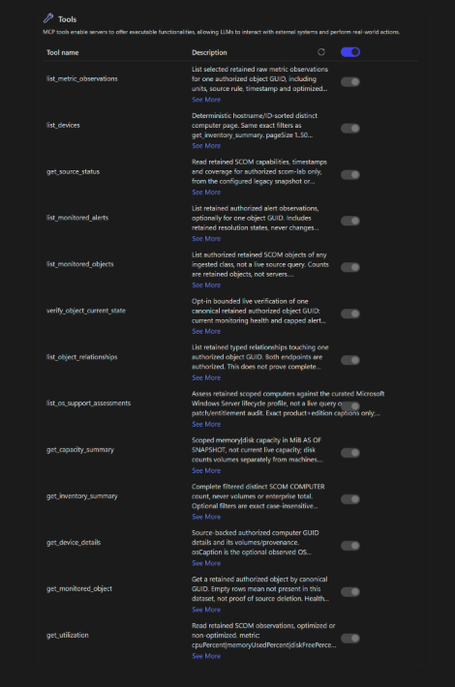

The Tools page shows 13 tools but only six are the documented inventory and lifecycle tools; the other seven (read-model, metrics and targeted-live) are also listed, and because metrics and targeted-live checks are disabled in this deployment they return an empty result or a "not enabled" style error (for example `LIVE_NOT_ENABLED`) instead of data.

At this point you should have a working connection: the agent lists the server's tools and
`<CALLBACK_URI>` is saved on the reader app. If sign-in fails with a redirect mismatch,
`<CALLBACK_URI>` was not saved on the reader app exactly as shown; see
[Troubleshooting](#troubleshooting).

## Step 9. Acceptance checks and Accept

Setup's Accept records that you ran these checks; it does not run them. State which you
skip. Run the PowerShell below in a normal Windows PowerShell 5.1 session on any machine that
can reach `https://<FQDN>`. These commands were assembled from the documented endpoints
([mcp-server-spec](mcp-server-spec.md)); if a response differs from what is described, stop
and use [Troubleshooting](#troubleshooting).

### 9.0 Prepare: a status helper and a test token

Define a helper that returns the HTTP status code instead of throwing on 401/403:

```powershell
[Net.ServicePointManager]::SecurityProtocol = [Net.SecurityProtocolType]::Tls12
function Get-HttpStatus {
    param([string]$Method = 'GET', [string]$Uri, [hashtable]$Headers = @{}, [string]$Body)
    $p = @{ Method = $Method; Uri = $Uri; Headers = $Headers; UseBasicParsing = $true }
    if ($Body) { $p.Body = $Body; $p.ContentType = 'application/json' }
    try { (Invoke-WebRequest @p).StatusCode -as [int] }
    catch { if ($_.Exception.Response) { [int]$_.Exception.Response.StatusCode } else { throw } }
}
```

Checks 3, 5, 6, 7 and 8 need a reader access token. Copilot Studio holds the real one, so
create a **temporary public-client "check app"** (delete it when you finish this step):

1. Entra admin center > Entra ID > App registrations > **New registration**. Name
   `scom-mcp-check-temp`, single tenant, redirect URI platform **Public client/native** with
   value `http://localhost`. Register, and copy the Application (client) ID as
   `<CHECK_CLIENT_ID>`.
2. Authentication > Advanced settings > **Allow public client flows** = Yes. Save.
3. API permissions > Add a permission > **My APIs** > the API app > **Delegated** >
   `Scom.Read` > Add. Then **Grant admin consent for `<your tenant>`** > Yes.

Get a token with the device-code flow. It prints a code; open the URL it shows in a browser
and sign in as an allow-listed reader (`<READER_USER_OBJECT_ID>`, Step 6):

```powershell
$tenant = '<TENANT_ID>'; $client = '<CHECK_CLIENT_ID>'
$dc = Invoke-RestMethod -Method Post -Uri "https://login.microsoftonline.com/$tenant/oauth2/v2.0/devicecode" `
    -Body @{ client_id = $client; scope = 'api://<API_APP_ID>/Scom.Read' }
Write-Host $dc.message
$token = $null
while (-not $token) {
    Start-Sleep -Seconds $dc.interval
    try {
        $token = (Invoke-RestMethod -Method Post -Uri "https://login.microsoftonline.com/$tenant/oauth2/v2.0/token" `
            -Body @{ grant_type = 'urn:ietf:params:oauth:grant-type:device_code'; client_id = $client; device_code = $dc.device_code }).access_token
    } catch {
        $e = $null
        try { $e = ($_.ErrorDetails.Message | ConvertFrom-Json).error } catch { }
        if ($e -ne 'authorization_pending') { throw }
    }
}
```

Keep `$token` in memory only; never write it to a file or paste it into a ticket. Then define
a helper that calls an MCP tool as that user:

```powershell
function Invoke-Mcp {
    param([string]$Tool, [hashtable]$Arguments = @{}, [string]$Token = $token)
    $body = @{ jsonrpc = '2.0'; id = 1; method = 'tools/call'; params = @{ name = $Tool; arguments = $Arguments } } |
        ConvertTo-Json -Depth 6 -Compress
    (Invoke-WebRequest -Method Post -Uri 'https://<FQDN>/mcp' -UseBasicParsing -ContentType 'application/json' `
        -Headers @{ Authorization = "Bearer $Token"; Accept = 'application/json, text/event-stream' } -Body $body).Content
}
```

### 9.1 The eight checks

1. **Health.** `Get-HttpStatus -Uri 'https://<FQDN>/healthz'` returns `200`.
2. **No token is refused.**
   `Get-HttpStatus -Method POST -Uri 'https://<FQDN>/mcp' -Headers @{ Accept = 'application/json, text/event-stream' } -Body '{}'`
   returns `401`.
3. **Source status.** The JSON-RPC body the server receives is:

   ```json
   {"jsonrpc":"2.0","id":1,"method":"tools/call","params":{"name":"get_source_status","arguments":{}}}
   ```

   Send it with `Invoke-Mcp -Tool get_source_status`. The server is stateless, so no
   `initialize` call is needed; if your server replies that a session is required, send an
   `initialize` request first. The response may arrive as a server-sent event (`data: {...}`).
   Expect the committed computer count, `freshness` = `fresh` and coverage complete (expected
   equals unique). The same result must appear when you ask the Copilot Studio agent.
4. **Computer count.** In the Operations console: Monitoring > Discovered Inventory > Change
   Target Type > **Windows Computer**; the number of in-scope instances (for group scope,
   the group's members) must equal the computer count from check 3.
5. **Inventory matches the console.**
   - OS: `Invoke-Mcp -Tool get_inventory_summary`; add up the `count` values of the
     `osCaption` breakdown. In the console, Discovered Inventory > Change Target Type >
     **Windows Operating System**. The in-scope **Discovered Inventory OS count** must equal
     the **OS edges** (the sum from the tool).
   - Disks: `Invoke-Mcp -Tool get_capacity_summary -Arguments @{ resource = 'disk' }`; read
     `matchingVolumeCount`. In the console, Change Target Type > **Windows Server Logical
     Disk**. The in-scope **Logical Disk count** must equal the **disk edges**
     (`matchingVolumeCount`).

   For group scope, count only the instances hosted by the group's computers. A mismatch
   means a mapping or scope problem: see 6f.
6. **Device details.** `Invoke-Mcp -Tool list_devices` returns each computer's `entityId`;
   for each, `Invoke-Mcp -Tool get_device_details -Arguments @{ entityId = '<ENTITY_ID>' }`
   returns the `device` and its `volumes`.
7. **A signed-in user who is not allow-listed is refused.** Repeat the device-code sign-in
   above as a user whose object ID is **not** in `Auth.Callers`, storing the result in
   `$otherToken`. Then:

   ```powershell
   Get-HttpStatus -Method POST -Uri 'https://<FQDN>/mcp' -Headers @{ Authorization = "Bearer $otherToken"; Accept = 'application/json, text/event-stream' } `
       -Body '{"jsonrpc":"2.0","id":1,"method":"tools/call","params":{"name":"get_source_status","arguments":{}}}'
   ```

   Expect `403`. (A user who is not assigned to the check app, or never consented, may be
   refused at sign-in instead, which is also a pass; record which.)
8. **A reader token cannot ingest.**

   ```powershell
   Get-HttpStatus -Method POST -Uri "https://<FQDN>/ingestion/sessions/$([guid]::NewGuid())" `
       -Headers @{ Authorization = "Bearer $token" } -Body '{}'
   ```

   Expect `403`: only the publisher's app-only `Scom.Ingest` role may write.

When you finish, delete the check app (Entra admin center > App registrations >
`scom-mcp-check-temp` > Delete) and close the session that holds `$token`.

### 9.2 Accept

Host lane, elevated, from `<pkg>`. Run it only after you have run (or consciously skipped)
the checks above:

```powershell
.\setup\Start-ScomSetup.ps1 -StateDirectory <state> -Step Accept
```

**APPROVE asks:** "Record operator attestation of intended-user Studio tool discovery,
committed inventory, unauthorized-user denial and scoped coverage. This is NOT automated
certification." Type `APPROVE`; any other answer cancels.

**Expected:** `SETUP_STAGE=accepted. No recurrence, metrics or targeted-live enabled.`

At this point you should have all eight checks recorded as passed (or skipped by you, by
name), the check app deleted, and setup at the `accepted` stage.

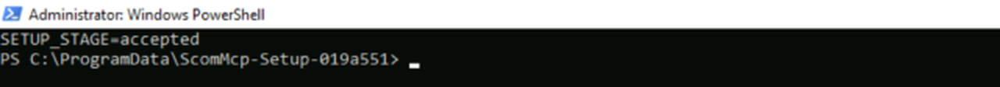

*The recorded setup stage, read from `setup-state.json` in the state directory after Accept (the Accept step itself was not re-run).*

## Step 10. Register recurrence

Register the single scheduled task that refreshes the snapshot every hour (the interval is
`schedule.interval` = `01:00:00` in `worker.json`, Step 6). It runs as `<WORKER_ACCOUNT>`
(from Step 3), which must hold **Log on as a batch job**; SYSTEM, LocalService and
NetworkService are rejected. Run in an **elevated** Windows PowerShell 5.1 on the collector host:

```powershell
$c = Get-Credential '<WORKER_ACCOUNT>'
& 'C:\ScomMcp\package\Operations\DurableIndexedRefresh\Register-ScomWorkerTask.ps1' `
    -WorkerDllPath 'C:\ScomMcp\install\server\ScomMcp.dll' `
    -WorkerConfigPath 'C:\ScomMcp\private\worker.json' `
    -StateDirectory 'C:\ScomMcp\worker-runtime' `
    -Credential $c -StartNow
```

- The password is typed into the `Get-Credential` prompt; never pass it as an argument.
- `-StateDirectory` must be a **new, empty** local NTFS directory (the script creates it and
  sets its ACL). If `C:\ScomMcp\worker-runtime` exists already, choose another.
- The command asks you to confirm before it registers (high-impact action); answer `Y`.
- The task name `SCOM-MCP Durable Indexed Refresh` must not already exist.

**Expected output** (an object with these values):

| Property | Value |
|---|---|
| `TaskName` / `TaskPath` | `SCOM-MCP Durable Indexed Refresh` / `\` |
| `WorkerIdentity` | `<WORKER_ACCOUNT>` |
| `State` | `start-requested` |
| `StartupTrigger` | `AtStartup` |
| `DuplicateInstancePolicy` | `IgnoreNew` |
| `AutomaticRestartCount` | `3` (`AutomaticRestartInterval` `PT5M`, `StartupDelay` `PT3M`) |
| `RuntimeStateDirectory` | `C:\ScomMcp\worker-runtime` |

Day-two commands (status, start, stop, re-arm, unregister) are in
[operations, recurrence](operations.md#recurrence). Confirm with `get_source_status` (Step 9,
check 3) after the first run: `collected_at` advances and freshness is `fresh`.

At this point you should have one scheduled task registered for `<WORKER_ACCOUNT>`, a
`collected_at` that advances each hour, and freshness `fresh`. Setup is complete.

## Step 11. Agent acceptance test

Ask the nine prompts in [copilot-studio-integration, Agent acceptance test](copilot-studio-integration.md#agent-acceptance-test)
and compare against the pass criteria. A transient "source unavailable" answer while a
collection commits is correct behaviour, not a failure.

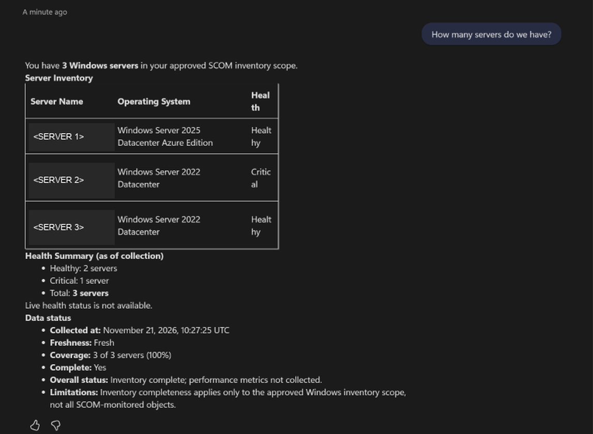

*The agent's answer to "How many servers do we have?", including the Data status block (server names redacted).*

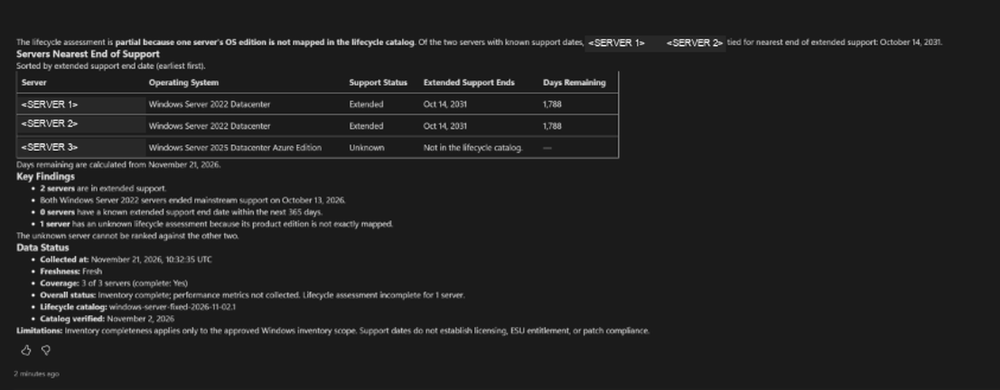

*The agent's answer to "Which servers are nearest end of support?" (server names redacted), including the Data Status block.*

You are done. Day-two operation (logs, policy changes, recovery, lifecycle catalog):
[operations](operations.md).

## Find a value again

| Value | Where to find it |
|---|---|
| `<TENANT_ID>` | Entra admin center > Overview, or `identity.json` |
| `<API_APP_ID>`, `<PUBLISHER_APP_ID>`, `<READER_APP_ID>` | Entra > App registrations > the app > Overview (Application (client) ID), or `identity.json` |
| `<PUBLISHER_SP_OBJECT_ID>` | Entra > **Enterprise applications** > the publisher > Object ID (not the app registration's Object ID) |
| `<READER_USER_OBJECT_ID>` | Entra > Users > the user > Object ID |
| Reader client secret | Not recoverable; create a new secret on the reader app and update the connector |
| `<CERT_THUMBPRINT>`, `<TLS_THUMBPRINT>` | `Get-ChildItem Cert:\LocalMachine\My \| Select Subject, Thumbprint, NotAfter` |
| `<CALLBACK_URI>` | Copilot Studio > the connector > its settings after creation |
| `<MG_ID>`, `<GROUP_ID>`, `<MGMT_SERVER_FQDN>`, `<OM_MODULE_PATH>` | The Step 3 commands, or the Operations console |
| Anything already installed | `<private>\worker.json`, `identity.json` and the receiver's installed `appsettings.json` |

## Troubleshooting

Start with [troubleshooting](troubleshooting.md) (first five checks, log locations and
every error code). The most common first-time problems:

| Symptom | Likely cause | See |
|---|---|---|
| Activate fails or a retry is refused | Server cannot resolve its own `<FQDN>` | [install-cli failure notes](install-cli.md#failure-notes) |
| 401 on every tool call | Token `aud` does not match `Auth.Audiences` (Step 6b) | [troubleshooting](troubleshooting.md) |
| 403 for a legitimate user | Their `<READER_USER_OBJECT_ID>` is not in `Auth.Callers` | [troubleshooting](troubleshooting.md) |
| Ingestion rejected | `<PUBLISHER_SP_OBJECT_ID>` is the app registration's ID, not the Enterprise application's | [entra-setup](entra-setup.md#where-each-value-lands) |
| Connector cannot reach the server | NSG rule missing `AzureConnectors` / `PowerPlatformPlugins`, or TLS certificate not trusted by Copilot Studio | [network-and-ports](network-and-ports.md) |
| Answers say data is stale | Recurrence not registered (Step 10) or interval longer than the freshness budget | [operations](operations.md) |
