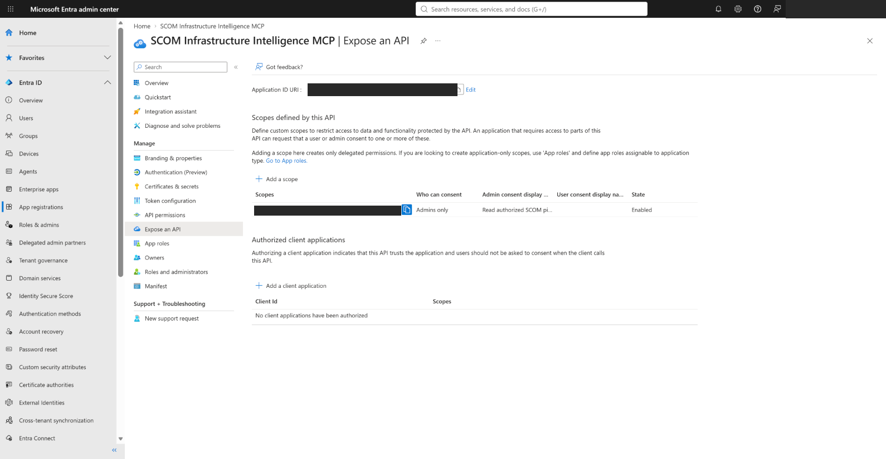
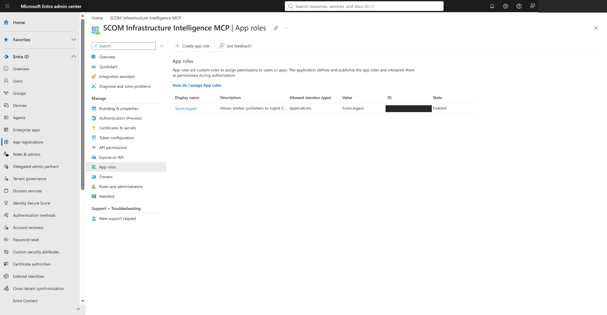
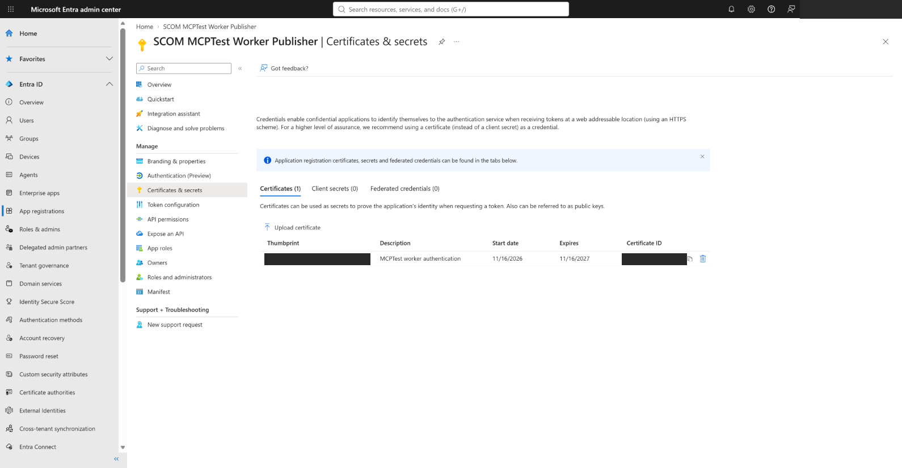
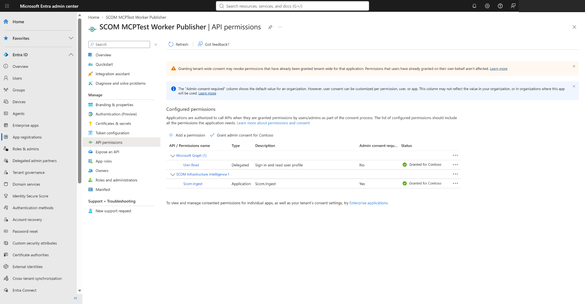
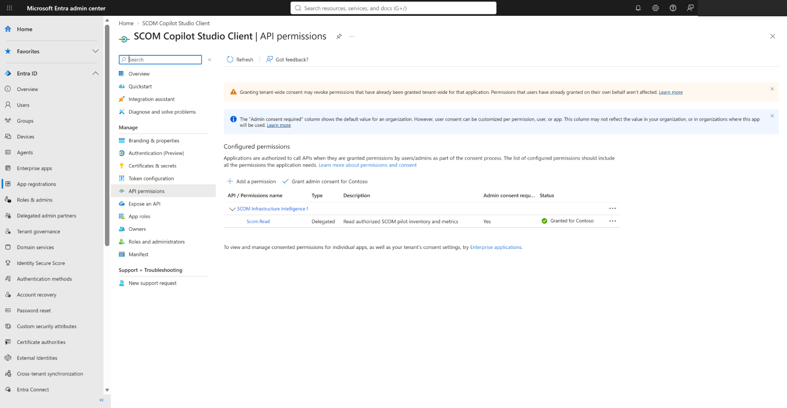

# Entra setup

Three app registrations in one tenant, all single-tenant (`AzureADMyOrg`). **No
Microsoft Graph permissions are requested or needed**; the publisher holds only the
`Scom.Ingest` app role and the reader holds only the delegated `Scom.Read` scope.

| Registration | Purpose | Credential | Permission |
|---|---|---|---|
| **API** (`<prefix>-api`) | Resource that the receiver validates tokens for | none | Defines scope `Scom.Read` (delegated, admin-only) and app role `Scom.Ingest` (application) |
| **Publisher** (`<prefix>-publisher`) | App-only identity of the collector worker | **Certificate** (public part only); no secrets | App role `Scom.Ingest` on the API, admin-consented |
| **Reader / Copilot Studio client** (`<prefix>-reader`) | OAuth client the connector uses for the signed-in user | Client secret entered only in the connector (manual OAuth) | Delegated `Scom.Read` on the API, consented |

API settings: `identifierUris` = `api://<API_APP_ID>`; `requestedAccessTokenVersion` = `2`;
scope `Scom.Read` (type **Admin**); app role `Scom.Ingest` (allowed member type
**Applications**).

## Route A: script

`Setup/Provision-ScomEntra.ps1` creates or verifies all three registrations and
writes a nonsecret `identity.json`. It does not acquire permissions itself.

Prerequisites: an authorized administrator signs in to Microsoft Graph PowerShell
(`Microsoft.Graph.Authentication`, global cloud, delegated) with
`Application.ReadWrite.All`, plus `AppRoleAssignment.ReadWrite.All` if you pass
`-GrantPublisherRole`. You also need the publisher's **public** certificate as a
`.cer` (no PFX, no private key).

```powershell
.\Setup\Provision-ScomEntra.ps1 `
  -TenantId <TENANT_ID> -NamePrefix <PREFIX> `
  -PublicCertificatePath <PUBLISHER_CERT.cer> `
  -StateDirectory <PRIVATE_STATE_DIR> -GrantPublisherRole
```

The script keeps an idempotent journal, refuses to reuse a conflicting app, never
deletes anything, and asks for confirmation before saving `identity.json` into the
private state directory. Reader consent for the Copilot Studio connector and the
connector's redirect URI are still handled separately (below).

## Route B: portal

1. **API app.** App registrations > New registration > *Accounts in this
   organizational directory only*. Expose an API: set the Application ID URI to
   `api://<API_APP_ID>`; add scope `Scom.Read` (who can consent: **Admins only**).
   App roles > Create: value `Scom.Ingest`, allowed member types **Applications**,
   enabled. In the manifest set `requestedAccessTokenVersion` to `2`.
2. **Publisher app.** New registration (single tenant, no redirect URI). Certificates
   & secrets > Certificates > upload the **public** `.cer` only. API permissions >
   Add > My APIs > the API > **Application permissions** > `Scom.Ingest`; then
   **Grant admin consent**. In Enterprise applications, open the publisher and record
   its **Object ID** (the service principal, not the app registration).
3. **Reader app.** New registration (single tenant). API permissions > My APIs >
   the API > **Delegated** > `Scom.Read`; grant consent as tenant policy requires.
   Create a client secret through your approved credential process and enter it only
   in the Copilot Studio connector. After the connector is created, add the redirect
   URI it displays as a **Web** redirect URI, exactly as shown.











More portal screenshots: see [screenshots/README.md](screenshots/README.md).

## Where each value lands

| Value | Where it comes from | Where it goes |
|---|---|---|
| `<TENANT_ID>` | Entra tenant ID | `identity.json` `tenantId`; receiver `Auth.TenantId`; worker `identity.tenantId` |
| `<API_APP_ID>` | API app (client) ID | `identity.json` `apiClientId` and `resource` (`api://<API_APP_ID>`); receiver `Auth.Audiences` (verify actual `aud`); worker `identity.resource` |
| `<PUBLISHER_APP_ID>` | Publisher app (client) ID | `identity.json` `publisherClientId`; worker `identity.clientId` |
| `<PUBLISHER_SP_OBJECT_ID>` | Enterprise application object ID of the publisher | `identity.json` `publisherObjectId`; receiver `ReadModel.PublisherObjectIds` |
| `<READER_APP_ID>` | Reader app (client) ID | `identity.json` `readerClientId`; connector **Client ID** |
| `<READER_USER_OBJECT_ID>` | Each authorized user's object ID | receiver `Auth.Callers[].ObjectId` |
| `<CERT_THUMBPRINT>` | Publisher certificate (`LocalMachine\My`) | `identity.json` `certificateThumbprint`; worker `identity.certificateThumbprint` |

See [`examples/identity.example.json`](../examples/identity.example.json).

## Admin consent and least privilege

- Admin consent is required once for the publisher's `Scom.Ingest` app role and
  (per tenant policy) for the reader's delegated `Scom.Read`.
- Do not add Graph permissions, additional scopes, or `User.Read` for this solution.
- The server separately allow-lists callers by user object ID; consenting to the
  scope does not by itself grant data access.
- Never commit secrets, PFX files or tokens. Plan secret and certificate rotation.
  Background: [technical-reference.md](technical-reference.md#publisher-identity-setup-entra-and-windows).
